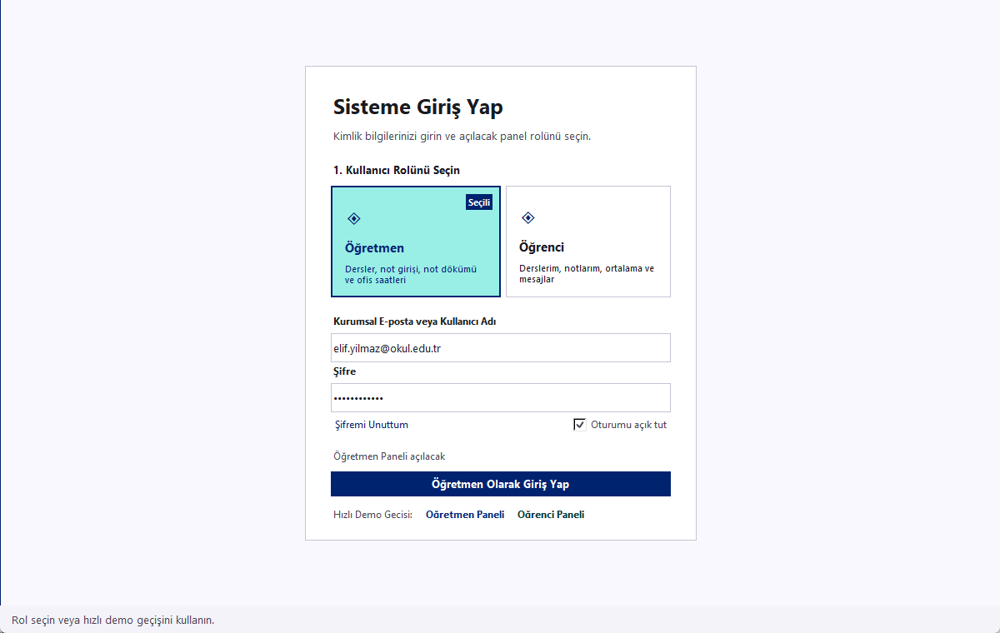
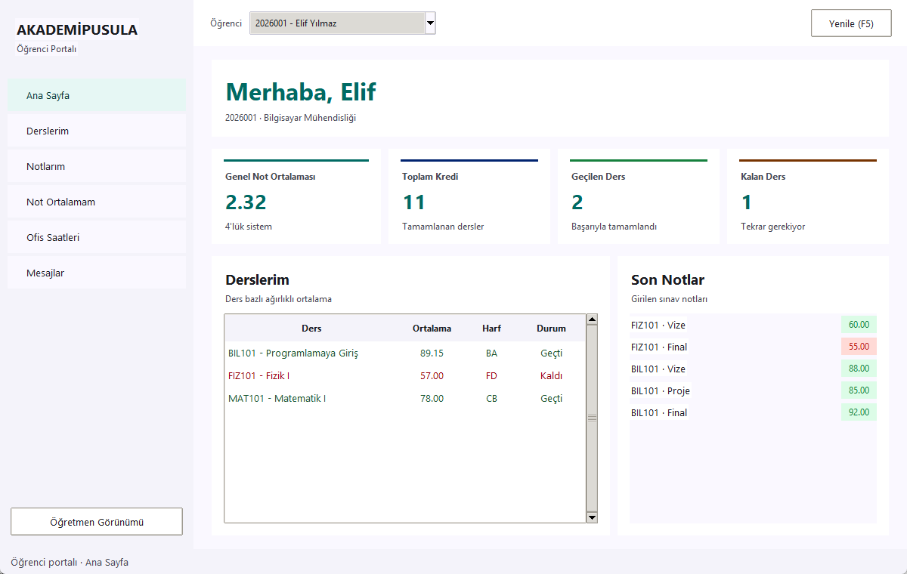
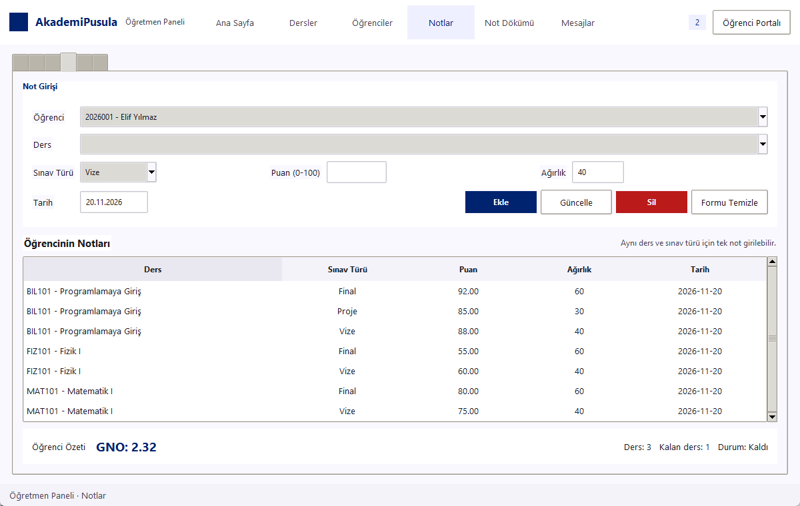
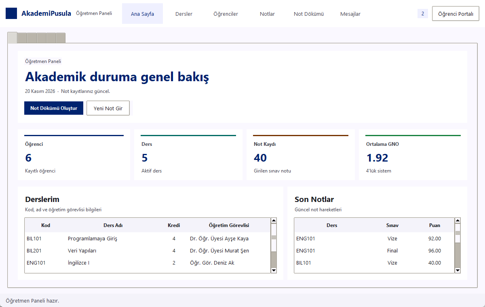

# AkademiPusula — Öğrenci Not Takip Sistemi

Python + Tkinter + SQLite ile geliştirilmiş, ek veritabanı sunucusu gerektirmeyen masaüstü
uygulaması. Öğrenci ve ders kayıtlarını yönetir, ağırlıklı ortalamaya göre harf notu ve GNO
hesaplar, PDF/CSV rapor üretir. Arayüz; lacivert öğretmen paneli ve turkuaz öğrenci portalı
olmak üzere iki rol görünümü sunar.






## Özellikler

- **Rol görünümleri:** giriş ekranından öğretmen/giriş veya öğrenci portalı seçimi; üst menülü
  öğretmen paneli ve sol kenar çubuklu öğrenci portalı.
- **Öğrenci yönetimi:** ekleme, güncelleme, silme, numara/ad/bölüm/e-posta ile arama.
- **Ders yönetimi:** ders kodu, ad, kredi, öğretim görevlisi ve dönem bilgisi.
- **Not yönetimi:** Vize, Final, Ödev ve Proje notları; her sınav türü için varsayılan ağırlık.
- **Otomatik hesaplama:** ders bazlı ağırlıklı ortalama, harf notu, geçme durumu ve kredi
  ağırlıklı GNO.
- **Raporlar:** öğrenci karnesi ve sınıf özeti; ekranda önizleme, PDF ve CSV çıktısı.
- **Ek ekranlar:** öğretmen ana sayfası, not dökümü, mesajlar; öğrenci not ortalaması,
  ofis saatleri ve mesajlar.
- **Veri güvenliği:** SQLite yabancı anahtar kısıtları, silme işlemlerinde otomatik cascade,
  menüden veritabanı yedeği alma.
- **Demo veri:** tek komutla 6 öğrenci, 5 ders ve 40 not kaydı.
- **Test ve kalite:** 106 pytest testi, `flake8` ve `pylint` yapılandırmaları, GitHub Actions CI.



## Hızlı Başlangıç

Gereksinim: **Python 3.11+** (geliştirme ve testler Python 3.15 ile yapıldı). Tkinter, Python
ile birlikte gelir; ayrıca kurulum gerekmez.

```powershell
cd ogrenci-not-takip
python -m venv .venv
.\.venv\Scripts\Activate.ps1
python -m pip install -r requirements-dev.txt
python main.py --demo
```

Windows'ta sanal ortam olmadan hızlı deneme:

```powershell
python -m pip install -r requirements.txt
python main.py --demo
```

Alternatif olarak `calistir.bat` dosyasına çift tıklayabilirsiniz.

### Komut satırı seçenekleri

| Komut | Açıklama |
| --- | --- |
| `python main.py` | Seçeneksiz (VS Code ▶ düğmesi dahil): demo veritabanı (`data/demo.db`), giriş ekranında demo hesapları |
| `python main.py --real` | Gerçek veritabanı (`data/notlar.db`) ile açılır; demo hesapları gösterilmez |
| `python main.py --demo --db data/demo.db` | Ayrı demo veritabanını açar; boşsa doldurur, doluysa **korur** |
| `python main.py --demo --db data/demo.db --reset-demo` | Demo veritabanını silip örnek verilerle yeniden oluşturur |
| `python main.py --demo` | `--demo --db data/demo.db` ile aynı |
| `python main.py --db baska.db` | Farklı bir SQLite dosyası kullanır |
| `python main.py --version` | Sürüm bilgisini yazar |

### Hesaplar ve giriş (sürüm 2.0)

- Giriş gerçek hesaplarla yapılır; parolalar PBKDF2-SHA256 ile özetlenerek saklanır.
- Gerçek veritabanında hiç öğretmen hesabı yoksa ilk açılışta **İlk Kurulum** ekranı
  ilk öğretmen hesabını oluşturur; sorumlusu atanmamış mevcut dersler bu hesaba atanır.
- Öğrenci hesapları **Öğrenciler** ekranındaki **Hesap Oluştur / Şifre Sıfırla** ile açılır;
  kullanıcı adı öğrenci numarasıdır. Diğer öğretmenler **Hesap → Öğretmen Hesabı Ekle**.
- `--demo`, gerçek veritabanına (`data/notlar.db`) veya gerçek veri içeren başka bir dosyaya
  asla yüklenmez.

Demo veritabanı (`data/demo.db`): 4 öğretmen, 2 sınıf düzeyinde 30 öğrenci
(2. sınıf: 2025-Güz, 3. sınıf: 2026-Bahar), 8 ders, her kayıt için vize/final/ödev notları
(birkaçı eksik) ve yaklaşık 40 mesaj (okunmuş ve okunmamış). Demo hesapları basit şifre
kullanır; gerçek hesaplarda şifre kuralı geçerlidir.

| Rol | Kullanıcı adı | Şifre |
| --- | --- | --- |
| Öğretmen | `ogretmen1`, `ogretmen2`, `ogretmen3`, `ogretmen4` | `1234` |
| Öğrenci | `ogrenci1` … `ogrenci30` | `1234` |

### Veritabanı sürüm geçişi

Eski (sürüm 1) bir veritabanı açıldığında otomatik olarak sürüm 2'ye güncellenir:
`users`, `enrollments`, `messages`, `message_recipients`, `meta` tabloları ve
`students.class_year`, `courses.teacher_id` sütunları eklenir; mevcut satırlar korunur ve
notu olan öğrenciler ilgili derslere kayıtlı sayılır. Güncellemeden önce dosyanın kopyası
aynı klasöre `<ad>.v1-yedek.db` olarak alınır.

Veritabanı ve çıktı klasörleri ilk çalıştırmada otomatik oluşturulur:

- `data/notlar.db` — SQLite veritabanı
- `cikti/` — PDF/CSV raporlarının varsayılan kayıt yeri

## Kullanım Akışı

0. Açılışta **Öğretmen** veya **Öğrenci** rolünü seçin; "Hızlı Demo Geçişi" bağlantıları
   giriş formunu doldurmadan ilgili panele geçer.
1. **Öğretmen Paneli → Öğrenciler** ekranından öğrenci ekleyin (öğrenci numarası benzersizdir).
2. **Dersler** sekmesinden ders tanımlayın; kredi 1-10 arasında tam sayı olmalıdır.
3. **Notlar** sekmesinde öğrenci ve dersi seçip sınav türünü, puanı ve ağırlığı girin.
   Ağırlık boş bırakılırsa sınav türünün varsayılan ağırlığı kullanılır.
4. Aynı öğrenci + ders + sınav türü için ikinci kez not girilemez; mevcut kaydı
   **Güncelle** ile değiştirin.
5. **Raporlar** sekmesinde önizlemeyi görüntüleyip PDF veya CSV olarak kaydedin.

## Not Hesaplama Kuralları

Ders ortalaması, girilen notların ağırlıklarına göre hesaplanır:

```
Ağırlıklı ortalama = Σ(puan × ağırlık) / Σ(ağırlık)
```

Varsayılan ağırlıklar:

| Sınav türü | Varsayılan ağırlık |
| --- | --- |
| Vize | 40 |
| Final | 60 |
| Ödev | 20 |
| Proje | 30 |

Harf notu ve katsayılar:

| Puan aralığı | Harf | Katsayı | Durum |
| --- | --- | --- | --- |
| 90 - 100 | AA | 4.00 | Geçti |
| 85 - 89.99 | BA | 3.50 | Geçti |
| 80 - 84.99 | BB | 3.00 | Geçti |
| 75 - 79.99 | CB | 2.50 | Geçti |
| 70 - 74.99 | CC | 2.00 | Geçti |
| 65 - 69.99 | DC | 1.50 | Geçti |
| 60 - 64.99 | DD | 1.00 | Geçti |
| 50 - 59.99 | FD | 0.50 | Kaldı |
| 0 - 49.99 | FF | 0.00 | Kaldı |

- Geçme eşiği **60 puandır** (DD ve üzeri).
- GNO, derslerin katsayıları krediyle ağırlıklandırılarak hesaplanır:

```
GNO = Σ(harf katsayısı × ders kredisi) / Σ(ders kredisi)
```

- Notu girilmemiş dersler ortalamaya ve GNO'ya dahil edilmez.
- Bir dersten kalındığında öğrencinin genel durumu **Kaldı** görünür.

> Örnek: Vize 80 (ağırlık 40) ve Final 60 (ağırlık 60) → ortalama 68.00 → DC → Geçti.

## Proje Yapısı

```
ogrenci-not-takip/
├── main.py                     # Giriş noktası (argparse, DB açılışı, Tk penceresi)
├── calistir.bat                # Windows için çift tıkla çalıştırma
├── requirements.txt            # Çalışma zamanı bağımlılığı (fpdf2)
├── requirements-dev.txt        # Test ve kalite araçları
├── pytest.ini                  # Pytest yapılandırması
├── .flake8                     # PEP 8 / karmaşıklık kuralları
├── .pylintrc                   # Pylint kuralları
├── .coveragerc                 # Kapsam ölçümü (arayüz hariç)
├── app/
│   ├── config.py               # Sabitler, varsayılan yollar, ağırlıklar
│   ├── database.py             # SQLite bağlantısı, şema, transaction yardımcıları
│   ├── models.py               # Student, Course, Grade, StudentReport...
│   ├── grading.py              # Saf hesaplama fonksiyonları (ağırlıklı ortalama, GNO)
│   ├── validators.py           # Girdi doğrulama ve ayrıştırma
│   ├── errors.py               # AppError, ValidationError, NotFoundError
│   ├── demo_data.py            # Demo veri seti
│   ├── services/
│   │   ├── student_service.py  # Öğrenci CRUD + arama
│   │   ├── course_service.py   # Ders CRUD + arama
│   │   ├── grade_service.py    # Not CRUD, karne ve sınıf özeti
│   │   └── report_service.py   # PDF (fpdf2) ve CSV çıktıları
│   └── ui/
│       ├── app_window.py       # Ana pencere, rol seçimi ve gezinme
│       ├── theme.py            # Renk, tipografi, kart ve rozet bileşenleri
│       ├── dashboard.py        # Öğretmen ana sayfası, not dökümü, mesajlar
│       ├── student_portal.py   # Öğrenci portalı ve ekranları
│       ├── students_tab.py     # Öğrenciler ekranı
│       ├── courses_tab.py      # Dersler ekranı
│       ├── grades_tab.py       # Notlar ekranı
│       ├── reports_tab.py      # Raporlar ekranı
│       └── common.py           # Treeview ve hata yardımcıları
├── tests/                      # 106 pytest testi
├── assets/                     # Uygulama ikonu (PNG ve ICO)
├── tools/                      # İkon, ekran görüntüsü, diyagram ve doküman betikleri
├── docs/
│   ├── src/                    # Doküman kaynakları (Markdown + Project_Definition.txt)
│   ├── deliverables/           # Teslim PDF'leri ve Project_Definition.txt
│   ├── diagrams.md             # Mermaid diyagramları
│   ├── kalite.md               # Ölçülen kalite metrikleri
│   ├── diagrams/               # PNG diyagram çıktıları
│   ├── mermaid/                # Tek tek .mmd diyagram dosyaları
│   └── ekran-*.png             # Arayüz ekran görüntüleri
└── .github/workflows/ci.yml    # GitHub Actions: test + flake8 + pylint
```

Katmanlar arası bağımlılık tek yönlüdür: `ui → services → database`. Hesaplama kuralları
(`grading.py`) veritabanından bağımsız saf fonksiyonlardır; bu sayede hızlı ve güvenilir
şekilde test edilir.

## Veritabanı Şeması

| Tablo | Alanlar | Not |
| --- | --- | --- |
| `students` | `id`, `student_no` (UNIQUE), `first_name`, `last_name`, `department`, `email`, `created_at` | Öğrenci numarası benzersiz |
| `courses` | `id`, `code` (UNIQUE), `name`, `credit` (1-10), `instructor`, `semester` | Ders kodu büyük harfe çevrilir |
| `grades` | `id`, `student_id` FK, `course_id` FK, `exam_type`, `score` (0-100), `weight`, `exam_date` | `(student_id, course_id, exam_type)` UNIQUE |

- `students` silinince ilgili `grades` kayıtları, `courses` silinince de o derse ait notlar
  `ON DELETE CASCADE` ile silinir.
- `PRAGMA foreign_keys = ON` her bağlantıda etkinleştirilir.
- Şema `app/database.py` içindeki `SCHEMA` sabitinde tanımlıdır; uygulama açılışında
  `CREATE TABLE IF NOT EXISTS` ile oluşturulur.

ER diyagramı ve diğerleri: [docs/diagrams.md](docs/diagrams.md)

## Testler ve Kod Kalitesi

```powershell
python -m pytest -q
python -m pytest --cov=app --cov-report=term-missing
python -m flake8 app tests main.py
python -m pylint app main.py
```

Ölçülen sonuçlar (31.10.2026, Python 3.15.1 / Windows):

| Metrik | Sonuç |
| --- | --- |
| pytest | **106 test geçti** |
| Kapsam (iş katmanı, `app/ui` hariç) | **%97** |
| flake8 | **0 uyarı** (satır ≤ 100, karmaşıklık ≤ 12) |
| pylint | **10.00 / 10** |

Ayrıntılar ve kapsam dışı bırakılan dosyaların gerekçesi: [docs/kalite.md](docs/kalite.md).

Arayüz, `AppWindow` örneği oluşturulup giriş, altı öğretmen ekranı ve altı öğrenci ekranı
gezilerek duman testinden geçirildi. Tkinter testleri ekran gerektirdiği için otomatik kapsam
ölçümüne dahil edilmedi.

## Teslim Dokümanları

Beş teslim dokümanı `docs/deliverables/` altındadır:

| Dosya | İçerik | Sayfa |
| --- | --- | --- |
| [`Project_Definition.txt`](docs/deliverables/Project_Definition.txt) | Proje tanımı, konu, amaç, araçlar | - |
| [`Coding_Standards.pdf`](docs/deliverables/Coding_Standards.pdf) | Kodlama ve kalite standartları | 13 |
| [`Requirement_Spec_Doc.pdf`](docs/deliverables/Requirement_Spec_Doc.pdf) | 50 işlevsel + 20 işlevsel olmayan gereksinim, 8 arayüz görüntüsü | 21 |
| [`Design_Doc.pdf`](docs/deliverables/Design_Doc.pdf) | Mimari, ayrıntılı tasarım, veri, rol/arayüz ve çıktı görselleri | 28 |
| [`Test_Results_Doc.pdf`](docs/deliverables/Test_Results_Doc.pdf) | 106 test, kapsam, hata günlüğü, 10 test/arayüz görüntüsü | 18 |

PDF'ler Markdown kaynaklarından üretilir. Yeniden üretmek için (Edge veya Chrome gerekir):

```powershell
python tools/build_docs.py
```

Ekran görüntüleri `python tools/make_screenshots.py` ile yeniden üretilebilir.

## PDF / CSV Çıktıları

- **PDF:** `fpdf2` ile A4 boyutunda, başlık/alt bilgi ve sayfa numarası içeren rapor.
  Türkçe karakterler için sistemde bulunan ilk Unicode font (Arial, Segoe UI, DejaVu,
  Liberation) kullanılır; font bulunamazsa metin latin-1 uyumlu hale getirilir.
- **CSV:** `csv` modülü, `;` ayırıcı ve `utf-8-sig` kodlama ile yazılır. Böylece Excel'de
  Türkçe karakterler bozulmadan açılır.
- Dosya adı önerileri `karne_<ogrenci_no>_<tarih>.pdf` ve `sinif_raporu_<tarih>.csv`
  biçimindedir.



## Diyagramlar

Mermaid kaynakları GitHub'da doğrudan görüntülenir:

- [ER diyagramı](docs/diagrams.md#1-er-diyagramı)
- [Kullanım durumu diyagramı](docs/diagrams.md#2-kullanım-durumu-diyagramı)
- [Mimari diyagram](docs/diagrams.md#3-mimari-diyagram)
- [Not girişi sıra diyagramı](docs/diagrams.md#4-not-girişi-sıra-diyagramı)
- [Not hesaplama akışı](docs/diagrams.md#5-not-hesaplama-akışı)

draw.io ile düzenlemek için `docs/mermaid/*.mmd` dosyalarını
**Arrange → Insert → Advanced → Mermaid** ile içe aktarabilirsiniz.

## Git ve GitHub

Yerel makinede Git kurulu değilse [git-scm.com/download/win](https://git-scm.com/download/win)
adresinden kurun. Depoyu sürüm kontrolüne almak için:

```powershell
git init -b main
git add .
git commit -m "feat: öğrenci not takip sistemi"
git remote add origin https://github.com/<kullanici>/ogrenci-not-takip.git
git push -u origin main
```

GitHub'da boş bir depo oluşturup yukarıdaki uzak adresi kullanın. `.github/workflows/ci.yml`
sayesinde her push ve pull request'te testler, kapsam, flake8 ve pylint otomatik çalışır.

## Yol Haritası

- [ ] Dönem bazlı filtreleme ve dönem sonu kapanışı
- [ ] Devamsızlık takibi ve otomatik kaldı işaretleme
- [ ] Excel (xlsx) dışa aktarma
- [ ] Çoklu kullanıcı / öğretmen girişi
- [ ] Arayüz için `pytest` + `xvfb` tabanlı otomatik testler

## Lisans

Bu proje eğitim amaçlı geliştirilmiştir; dilediğiniz gibi kullanabilirsiniz.
