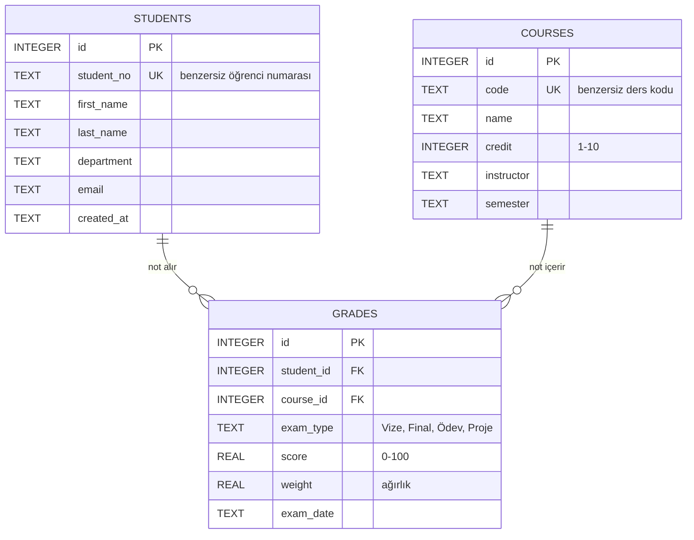
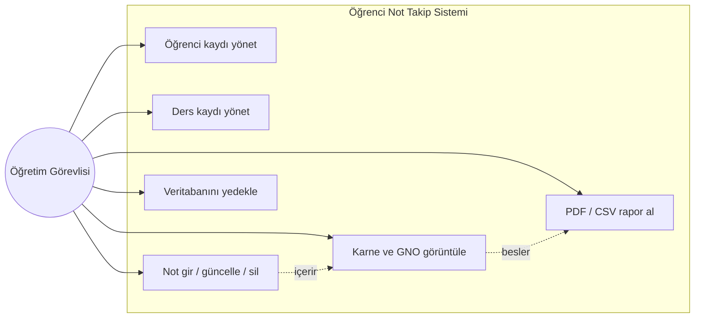
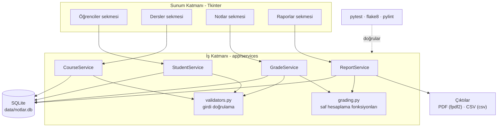
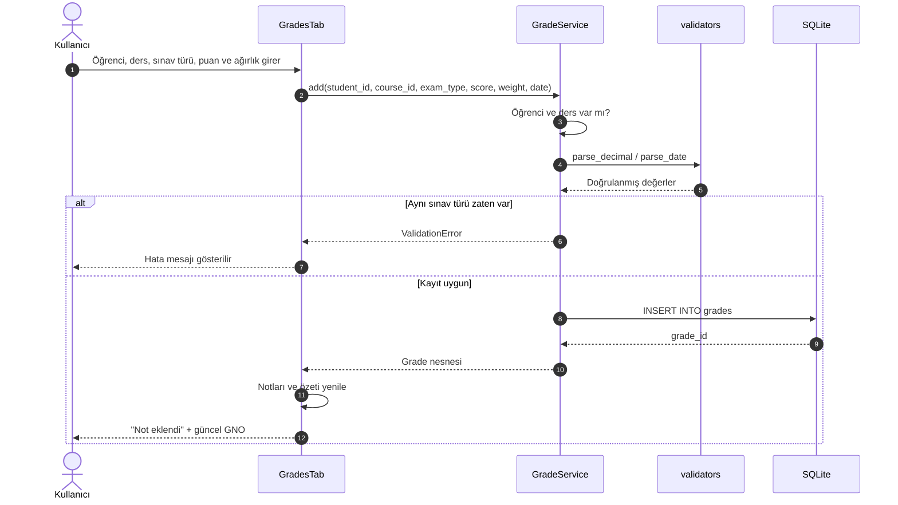
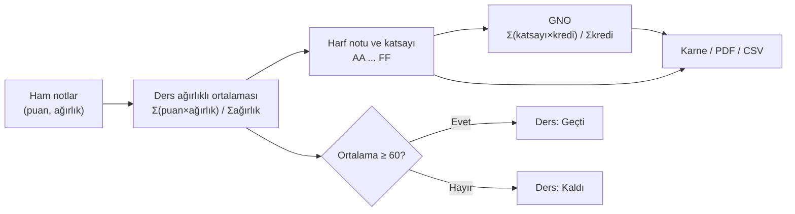

# Diyagramlar

Tüm diyagramlar [Mermaid](https://mermaid.js.org/) ile yazılmıştır. GitHub, GitLab ve
Mermaid eklentisi kurulu VS Code'da doğrudan görüntülenir. draw.io'da düzenlemek için
`docs/mermaid/` altındaki `.mmd` dosyalarını **Arrange → Insert → Advanced → Mermaid**
menüsünden içe aktarabilirsiniz.

## 1. ER Diyagramı

Veritabanı şeması ve ilişkiler:

- Bir öğrenci çok sayıda nota, bir ders çok sayıda nota sahiptir.
- `(student_id, course_id, exam_type)` üçlüsü benzersizdir; aynı sınav türü iki kez girilemez.
- Silme işlemleri `ON DELETE CASCADE` ile notlara yansır.

## 2. Kullanım Durumu Diyagramı

## 3. Mimari Diyagram

Katmanlı mimari; bağımlılıklar tek yönlüdür (`ui → services → database`).

## 4. Not Girişi Sıra Diyagramı

## 5. Not Hesaplama Akışı

## Katman Sorumlulukları

| Katman | Dosyalar | Sorumluluk |
| --- | --- | --- |
| Sunum | `app/ui/*` | Widget'lar, kullanıcı etkileşimi, hata mesajları |
| İş | `app/services/*`, `app/grading.py`, `app/validators.py` | İş kuralları, doğrulama, hesaplama, rapor üretimi |
| Veri | `app/database.py`, `app/models.py` | Bağlantı, şema, transaction, satır modelleri |
| Altyapı | `app/config.py`, `app/errors.py`, `app/demo_data.py` | Sabitler, hata türleri, demo veri |

## Renk / Biçim Notları

- Diyagramlarda Türkçe karakterler doğrudan kullanılabilir.
- draw.io içe aktarımında Mermaid'in desteklemediği özel biçimlendirmeler (gölge, ikon)
  kaybolabilir; kutu ve oklar korunur.
