# 1. Giriş

## 1.1 Amaç

Bu doküman, Öğrenci Not Takip Sistemi'nin (ONTS) yazılım mimarisini, bileşenlerini, veri yapısını, arayüz tasarımını ve teknik kararlarını açıklar. Doküman; gereksinim dokümanındaki davranışların kodda nasıl karşılandığını göstermek, bakım yapacak geliştiriciye yol haritası sunmak ve tasarımın test edilebilirliğini ortaya koymak amacıyla hazırlanmıştır.

## 1.2 Kapsam

Kapsam; `main.py`, `app/` altındaki tüm katmanlar, SQLite şeması, PDF/CSV üretimi, hata yönetimi, arayüz yerleşimi ve dağıtım/çalıştırma biçimidir. Test kodunun ayrıntıları Test Sonuçları dokümanında, kodlama kuralları Coding Standards dokümanında ele alınır.

## 1.3 Tasarım İlkeleri

Tasarım aşağıdaki ilkelere dayanır:

1. **Katmanların ayrılması:** Arayüz, iş kuralları ve veri erişimi birbirinden ayrıdır; bağımlılık tek yönlüdür.
2. **Saf hesaplama:** Not kuralları veritabanından bağımsız fonksiyonlarla ifade edilir; kolay ve hızlı test edilir.
3. **Tek sorumluluk:** Her servis yalnızca kendi varlık alanından sorumludur.
4. **Savunmacı doğrulama:** Aynı kural hem serviste hem veritabanında (CHECK/UNIQUE/FK) uygulanır.
5. **Kullanıcıya anlamlı hata:** Teknik istisnalar kullanıcı diline çevrilir.
6. **Basitlik:** Küçük ölçekli proje için sunucu, ORM veya harici bağımlılık eklenmez.

# 2. Sistem Genel Bakış

## 2.1 Problem ve Çözüm

Öğretim görevlisinin notları Excel veya kâğıt üzerinde tutması; formül hatası, sürüm karmaşası ve rapor üretiminde zaman kaybı yaratır. ONTS, tek bir masaüstü uygulamasında:

- öğrenci ve ders kayıtlarını,
- sınav türüne göre ağırlıklı notları,
- otomatik harf notu ve GNO'yu,
- PDF/CSV karne ve sınıf raporlarını

bir araya getirir. Veri yerel SQLite dosyasında tutulur; internet veya sunucu gerekmez.

## 2.2 Temel Yetenekler

| Yetenek | Bileşen | Çıktı |
| --- | --- | --- |
| Öğrenci yönetimi | `StudentService`, `StudentsTab` | Liste, arama, CRUD |
| Ders yönetimi | `CourseService`, `CoursesTab` | Liste, arama, CRUD |
| Not yönetimi | `GradeService`, `GradesTab` | Not listesi, özet |
| Hesaplama | `grading.py` | Ortalama, harf, katsayı, GNO |
| Raporlama | `ReportService`, `ReportsTab` | Önizleme, PDF, CSV |
| Veri yönetimi | `Database`, `demo_data.py` | Şema, transaction, yedek, demo |
| Kalite | `tests/`, CI | 106 test, kapsam, statik analiz |

## 2.3 Bağlam Diyagramı

Sistem tek kullanıcı ve tek dosya ile çalışır. Dış bağımlılıklar yalnızca yerel dosya sistemi, SQLite ve PDF fontlarıdır.

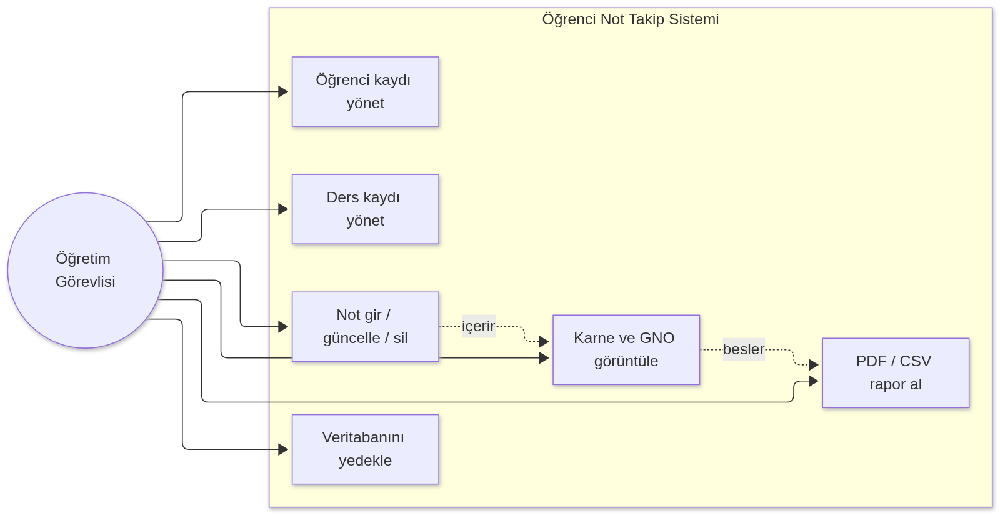

| Aktör / sistem | Etkileşim | Yön |
| --- | --- | --- |
| Öğretim görevlisi | Form, liste, menü | Girdi |
| SQLite dosyası | Okuma/yazma | Çift yönlü |
| Dosya sistemi | PDF/CSV kaydı, yedek | Çıktı |
| Sistem fontları | PDF Türkçe karakter | Girdi |

# 3. Mimari Tasarım

## 3.1 Katmanlı Mimari

Uygulama üç ana katman ve iki destek modülünden oluşur:

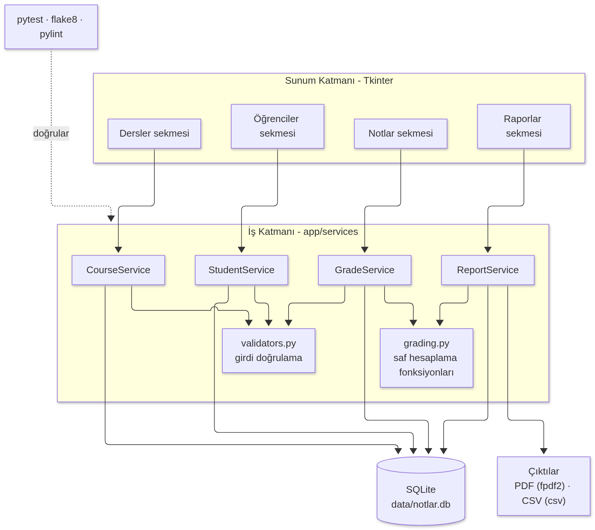

| Katman | Paket / dosyalar | Sorumluluk | Bağımlılık |
| --- | --- | --- | --- |
| Sunum | `app/ui/*` | Widget'lar, kullanıcı etkileşimi, mesajlar | Servisler |
| İş | `app/services/*`, `grading.py`, `validators.py` | İş kuralları, hesaplama, doğrulama, rapor | Veri katmanı |
| Veri | `app/database.py`, `app/models.py` | Bağlantı, şema, transaction, modeller | SQLite |
| Altyapı | `app/config.py`, `app/errors.py`, `app/demo_data.py` | Sabitler, hatalar, demo veri | - |
| Giriş | `main.py` | CLI, veritabanı açılışı, pencere başlatma | Tümü |

**Bağımlılık kuralı:** Oklar yalnızca yukarıdan aşağıya doğrudur: `ui → services → database`. `database.py` hiçbir servisi, servisler hiçbir UI sınıfını import etmez. `grading.py` hiçbir uygulama modülüne bağımlı değildir; bu sayede saf fonksiyon olarak test edilir.

## 3.2 Modül Sorumlulukları

| Modül | Genel sorumluluk | Öne çıkan semboller |
| --- | --- | --- |
| `app/config.py` | Sabitler, yollar, ağırlıklar, dönemler | `APP_NAME`, `DEFAULT_WEIGHTS`, `EXAM_TYPES` |
| `app/database.py` | Bağlantı, şema, transaction | `Database`, `SCHEMA` |
| `app/models.py` | Değişmez veri modelleri | `Student`, `Course`, `Grade`, `StudentReport` |
| `app/grading.py` | Saf hesaplama | `weighted_average`, `letter_grade`, `compute_gpa` |
| `app/validators.py` | Girdi temizleme/doğrulama | `parse_decimal`, `parse_date`, `validate_email` |
| `app/errors.py` | Hata hiyerarşisi | `AppError`, `ValidationError`, `NotFoundError` |
| `app/demo_data.py` | Örnek veri | `load_demo_data` |
| `app/services/student_service.py` | Öğrenci CRUD + arama | `StudentService` |
| `app/services/course_service.py` | Ders CRUD + arama | `CourseService` |
| `app/services/grade_service.py` | Not CRUD, karne, sınıf özeti | `GradeService` |
| `app/services/report_service.py` | PDF/CSV/önizleme | `ReportService`, `ReportPDF` |
| `app/ui/app_window.py` | Ana pencere, menü, durum çubuğu | `AppWindow` |
| `app/ui/*_tab.py` | Sekme yerleşimleri | `StudentsTab`, `CoursesTab`, `GradesTab`, `ReportsTab` |
| `app/ui/common.py` | Tema ve ortak widget yardımcıları | `configure_styles`, `make_tree`, `show_error` |

## 3.3 Çalışma Zamanı Görünümü

1. `main.py` argümanları ayrıştırır ve `Database` oluşturur.
2. `Database.__init__` dosyayı açar, `PRAGMA foreign_keys = ON` uygular ve şemayı oluşturur.
3. `AppWindow` dört servisi ve dört sekmeyi oluşturur.
4. `refresh_all()` her sekmeyi ilk verilerle doldurur.
5. Kullanıcı eylemi → sekme → servis → veritabanı zinciri çalışır.
6. Başarılı işlemde `notify_change()` tüm sekmeleri yeniler ve durum çubuğunu günceller.
7. Kapanışta `WM_DELETE_WINDOW` bağlantıyı kapatır.

# 4. Ayrıntılı Tasarım

## 4.1 Veri Modelleri

Modeller `@dataclass` ile tanımlanır. Öğrenci, ders ve not modelleri `frozen=True` (değişmez) olup veritabanı satırından `from_row` sınıf metoduyla üretilir.

| Sınıf | Alanlar | Türetilmiş özellik | Kullanım |
| --- | --- | --- | --- |
| `Student` | `id`, `student_no`, `first_name`, `last_name`, `department`, `email`, `created_at` | `full_name`, `label` | Öğrenci listesi, form |
| `Course` | `id`, `code`, `name`, `credit`, `instructor`, `semester` | `label` | Ders listesi, not formu |
| `Grade` | `id`, `student_id`, `course_id`, `exam_type`, `score`, `weight`, `exam_date`, `course_code`, `course_name` | - | Not listesi |
| `CourseAverage` | `course_id`, `course_code`, `course_name`, `credit`, `average`, `letter`, `point`, `passed`, `grade_count` | `status` | Karne satırı |
| `StudentReport` | `student`, `courses`, `gpa`, `total_credit` | `failed_count`, `status` | Karne özeti |
| `ClassSummary` | `student_id`, `student_no`, `full_name`, `department`, `course_count`, `gpa`, `failed_count`, `status` | - | Sınıf raporu |

**Neden dataclass?** Sözlüklerle çalışmak yerine tip güvenli, okunabilir ve otomatik `__eq__`/`__repr__` sağlayan nesneler elde edilir. `frozen=True`, modelin yanlışlıkla değiştirilmesini engeller.

## 4.2 Not Hesaplama Tasarımı

### 4.2.1 Ders Ağırlıklı Ortalaması

\[
\text{ortalama} = \frac{\sum_{i=1}^{n} (puan_i \times ağırlık_i)}{\sum_{i=1}^{n} ağırlık_i}
\]

- Ağırlığı sıfır veya negatif olan satırlar atlanır.
- Toplam ağırlık sıfırsa sonuç `None`'dur.
- Sonuç 2 ondalık basamağa yuvarlanır (`round(..., 2)`).

```python
def weighted_average(items):
    total_weight = 0.0
    total_score = 0.0
    for score, weight in items:
        if weight <= 0:
            continue
        total_score += float(score) * float(weight)
        total_weight += float(weight)
    if total_weight <= 0:
        return None
    return round(total_score / total_weight, 2)
```

### 4.2.2 Harf Notu ve Katsayı

| Alt sınır | Harf | Katsayı | Durum |
| --- | --- | --- | --- |
| 90.0 | AA | 4.0 | Geçti |
| 85.0 | BA | 3.5 | Geçti |
| 80.0 | BB | 3.0 | Geçti |
| 75.0 | CB | 2.5 | Geçti |
| 70.0 | CC | 2.0 | Geçti |
| 65.0 | DC | 1.5 | Geçti |
| 60.0 | DD | 1.0 | Geçti |
| 50.0 | FD | 0.5 | Kaldı |
| 0.0 | FF | 0.0 | Kaldı |

Ölçek büyükten küçüğe sıralı bir demettir; ilk eşleşen alt sınır kullanılır. Bu tasarım, `if/elif` zincirini veri odaklı bir tabloya dönüştürür ve yeni bir eşik eklemeyi kolaylaştırır. Geçme eşiği ayrı bir sabittir (`PASS_THRESHOLD = 60.0`).

### 4.2.3 GNO

\[
\text{GNO} = \frac{\sum_{j=1}^{m} (katsayı_j \times kredi_j)}{\sum_{j=1}^{m} kredi_j}
\]

- Yalnızca notu girilmiş dersler hesaba katılır.
- Kredisi sıfır veya negatif olan dersler atlanır.
- Ders yoksa GNO `None` döner ve arayüzde `-` gösterilir.

### 4.2.4 Akış

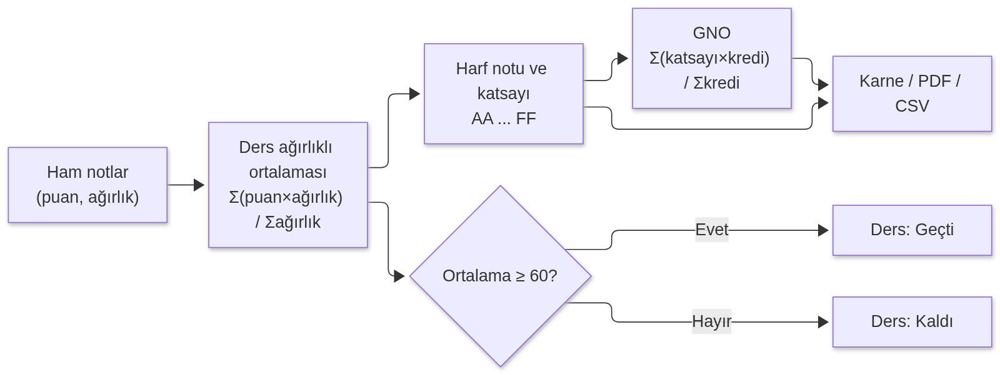

## 4.3 Servis Tasarımı

### 4.3.1 `StudentService`

| Metot | Parametreler | Dönüş | İş kuralı |
| --- | --- | --- | --- |
| `add` | `student_no, first_name, last_name, department="", email=""` | `Student` | Doğrula, benzersizliği koru |
| `update` | `student_id, ...` | `Student` | Kayıt var mı, doğrula |
| `delete` | `student_id` | `None` | Yoksa `NotFoundError` |
| `get` | `student_id` | `Student` | Yoksa `NotFoundError` |
| `list` | `search=""` | `list[Student]` | Beş alanda `LIKE` arama |
| `count` | - | `int` | Toplam kayıt |

### 4.3.2 `CourseService`

| Metot | Parametreler | Dönüş | İş kuralı |
| --- | --- | --- | --- |
| `add` | `code, name, credit=3, instructor="", semester=""` | `Course` | Kodu büyük harfe çevir, benzersiz kıl |
| `update` | `course_id, ...` | `Course` | Kayıt var mı, doğrula |
| `delete` | `course_id` | `None` | Yoksa `NotFoundError` |
| `get` | `course_id` | `Course` | Yoksa `NotFoundError` |
| `list` | `search=""` | `list[Course]` | Kod, ad, görevli, dönem araması |
| `count` | - | `int` | Toplam kayıt |

### 4.3.3 `GradeService`

| Metot | Parametreler | Dönüş | İş kuralı |
| --- | --- | --- | --- |
| `add` | `student_id, course_id, exam_type, score, weight=None, exam_date=None` | `Grade` | Öğrenci/ders var mı, tür geçerli mi, tekillik |
| `update` | `grade_id, ...` | `Grade` | Kayıt var mı, tekillik |
| `delete` | `grade_id` | `None` | Yoksa `NotFoundError` |
| `get` | `grade_id` | `Grade` | Ders bilgisiyle birleşik |
| `list_by_student` | `student_id` | `list[Grade]` | Ders kodu + sınav türü sırası |
| `list_by_course` | `course_id` | `list[Grade]` | Puana göre azalan |
| `count` | - | `int` | Toplam not |
| `student_report` | `student_id` | `StudentReport` | Derslere göre grupla, hesapla |
| `class_summary` | - | `list[ClassSummary]` | Her öğrenci için karne özeti |

`student_report` akışı:

```text
1. Öğrenciyi bul (yoksa NotFoundError).
2. Notları ders bilgisiyle birlikte çek.
3. Satırları course_id'ye göre grupla; her grupta (puan, ağırlık) listesi tut.
4. Her grup için weighted_average hesapla; None olanları atla.
5. Harf, katsayı, geçme durumu ve kredi ile CourseAverage oluştur.
6. compute_gpa ile GNO, toplam kredi ve kalan ders sayısını hesapla.
7. StudentReport döndür.
```

### 4.3.4 `ReportService`

| Metot | Çıktı | Biçim |
| --- | --- | --- |
| `student_csv(student_id, path)` | `Path` | `;` ayrımlı, `utf-8-sig` |
| `class_csv(path)` | `Path` | Sınıf özeti |
| `student_pdf(student_id, path)` | `Path` | A4, tablo, özet |
| `class_pdf(path)` | `Path` | A4, tüm öğrenciler |
| `student_preview(student_id)` | `str` | Sabit genişlikli metin |
| `class_preview()` | `str` | Sabit genişlikli metin |

PDF tarafında `ReportPDF(FPDF)` sınıfı ortak başlık, alt bilgi, sayfa numarası ve Türkçe font yönetimini üstlenir. Font çözümlemesi şu sırayla yapılır: Arial → Segoe UI → DejaVu Sans → Liberation Sans → Helvetica (latin-1 fallback). Böylece Windows, Linux ve macOS'ta çalışır.

## 4.4 Not Girişi Sıra Diyagramı

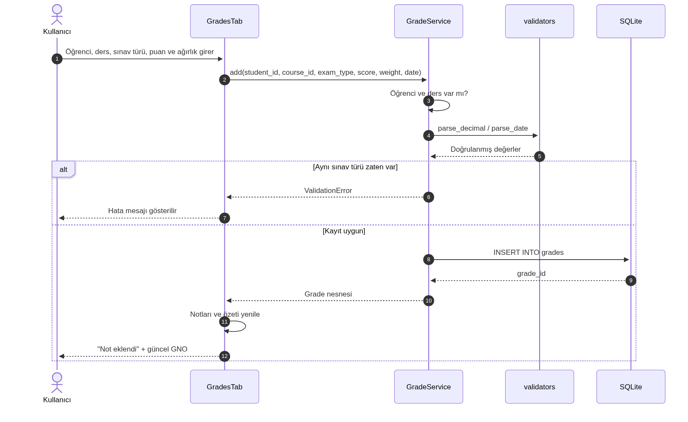

Adımlar:

1. Kullanıcı öğrenci, ders, sınav türü, puan, ağırlık ve tarih girer.
2. `GradesTab`, `GradeService.add` çağırır.
3. Servis öğrenci ve dersin varlığını doğrular.
4. `validators` puan, ağırlık ve tarihi ayrıştırır.
5. Aynı üçlü varsa `sqlite3.IntegrityError` → `ValidationError` dönüşümü yapılır.
6. Kayıt eklenirse `Grade` nesnesi döner; arayüz listeyi ve özeti yeniler.

## 4.5 Doğrulama Tasarımı

| Katman | Doğrulama | Örnek |
| --- | --- | --- |
| Arayüz | Seçim kontrolü, boş form uyarısı | "Önce bir öğrenci seçin." |
| Servis | İş kuralı ve biçim | `parse_decimal`, `parse_date`, regex |
| Veritabanı | Bütünlük | `CHECK`, `UNIQUE`, `FOREIGN KEY` |

Aynı kuralın iki katmanda bulunması bilinçlidir: arayüz kullanıcıyı yönlendirir, veritabanı ise kod hatası veya eşzamanlı erişim durumunda bile bozuk veriyi engeller.

## 4.6 Hata Yönetimi Tasarımı

```text
Kullanıcı girdisi
   │
   ▼
validators ── ValidationError ──┐
   │                             │
   ▼                             │
servis ── NotFoundError ─────────┤
   │                             │
   ▼                             │
SQLite ── IntegrityError ──► ValidationError
   │
   ▼
UI: AppError yakala → messagebox.showerror
```

- Teknik istisnalar servis sınırında kullanıcı diline çevrilir.
- UI yalnızca `AppError` bilir; `sqlite3` hatası doğrudan gösterilmez.
- Beklenmeyen istisnalar `main.py` düzeyinde traceback ile korunur.

## 4.7 Rapor Üretim Tasarımı

### PDF

1. `ReportPDF` oluşturulur; Unicode font varsa eklenir.
2. `add_page()` ile A4 sayfa açılır.
3. Öğrenci bilgisi ve bölüm başlıkları çizilir.
4. `_draw_table` başlık + zebra satırları yazar; uzun metin `_shorten` ile kısaltılır.
5. Özet (GNO, kredi, kalan ders, durum) `multi_cell` ile yazılır.
6. `output(path)` dosyayı üretir; hedef klasör yoksa oluşturulur.

### CSV

1. `csv.writer` ile `;` ayırıcı ve `utf-8-sig` açılır.
2. Öğrenci karne dosyasında önce anahtar-değer bloğu, boş satır, sonra ders tablosu yazılır.
3. `utf-8-sig`, Excel'in Türkçe karakterleri doğru açmasını sağlar.

## 4.8 Demo Veri Tasarımı

`demo_data.py`, 6 öğrenci, 5 ders ve 40 not içeren sabit demetler barındırır. `INSERT OR IGNORE` kullanıldığı için işlem **idempotent**tir: aynı veri iki kez yüklenirse çoğaltmaz, yalnızca eksikleri ekler. Demo veri, uygulamanın ilk izlenimini ve rapor çıktısını göstermek için tasarlanmıştır.

# 5. Veri Tasarımı

## 5.1 ER Diyagramı

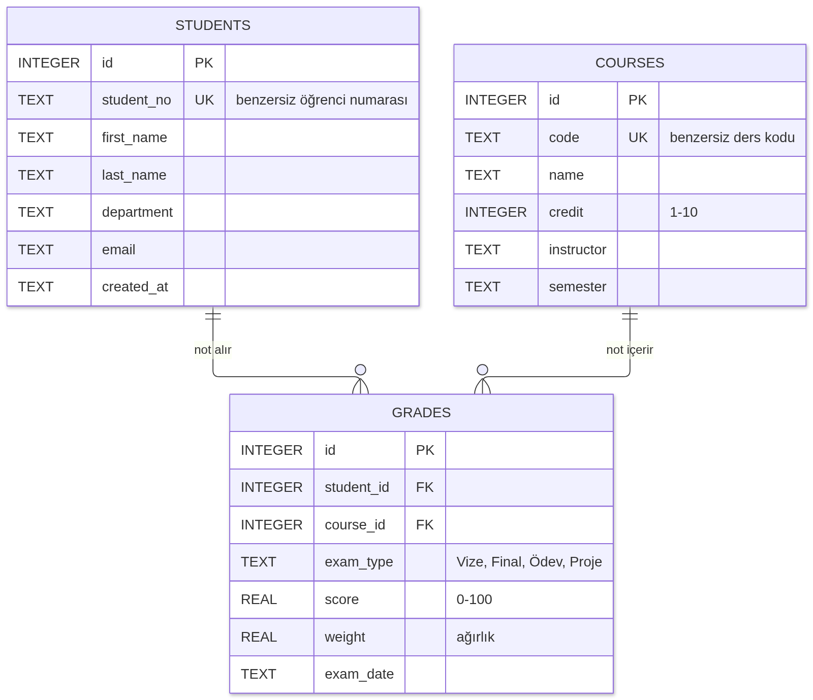

## 5.2 Şema

```sql
CREATE TABLE students (
    id          INTEGER PRIMARY KEY AUTOINCREMENT,
    student_no  TEXT    NOT NULL UNIQUE,
    first_name  TEXT    NOT NULL,
    last_name   TEXT    NOT NULL,
    department  TEXT    NOT NULL DEFAULT '',
    email       TEXT    NOT NULL DEFAULT '',
    created_at  TEXT    NOT NULL DEFAULT (datetime('now', 'localtime'))
);

CREATE TABLE courses (
    id          INTEGER PRIMARY KEY AUTOINCREMENT,
    code        TEXT    NOT NULL UNIQUE,
    name        TEXT    NOT NULL,
    credit      INTEGER NOT NULL DEFAULT 3 CHECK (credit BETWEEN 1 AND 10),
    instructor  TEXT    NOT NULL DEFAULT '',
    semester    TEXT    NOT NULL DEFAULT ''
);

CREATE TABLE grades (
    id          INTEGER PRIMARY KEY AUTOINCREMENT,
    student_id  INTEGER NOT NULL REFERENCES students(id) ON DELETE CASCADE,
    course_id   INTEGER NOT NULL REFERENCES courses(id) ON DELETE CASCADE,
    exam_type   TEXT    NOT NULL,
    score       REAL    NOT NULL CHECK (score BETWEEN 0 AND 100),
    weight      REAL    NOT NULL DEFAULT 1 CHECK (weight > 0),
    exam_date   TEXT    NOT NULL DEFAULT (date('now')),
    UNIQUE (student_id, course_id, exam_type)
);

CREATE INDEX idx_grades_student ON grades(student_id);
CREATE INDEX idx_grades_course ON grades(course_id);
```

## 5.3 İlişkiler ve Bütünlük

| İlişki | Kardinalite | Silme davranışı |
| --- | --- | --- |
| `students` → `grades` | 1 : N | `ON DELETE CASCADE` |
| `courses` → `grades` | 1 : N | `ON DELETE CASCADE` |

- `PRAGMA foreign_keys = ON` her bağlantıda çalıştırılır; aksi halde SQLite FK kısıtlarını uygulamaz.
- `UNIQUE (student_id, course_id, exam_type)` iş kuralını veritabanı düzeyinde garanti eder.
- `CHECK` kısıtları puan, ağırlık ve kredi aralığını korur.
- Silme sırasında notların otomatik silinmesi, yetim kayıt oluşmasını engeller.

## 5.4 Normalizasyon

Şema **3. Normal Form**'a yakındır:

- Her tablo tek bir varlığı temsil eder.
- Ders kodu ve adı yalnızca `courses` tablosunda tutulur; `grades` kaydı `course_id` ile ilişkilendirilir.
- Hesaplanan değerler (ortalama, harf, GNO) saklanmaz; her okumada türetilir. Bu, veri tutarsızlığını önler ve kural değiştiğinde yeniden hesaplamayı garantiler.
- Rapor sorguları `JOIN` ile ders bilgisini getirir; denormalizasyon yalnızca okuma kolaylığı için sorgu düzeyinde yapılır.

## 5.5 İndeksleme ve Performans

| İndeks | Amaç |
| --- | --- |
| `students.student_no` (UNIQUE) | Numarayla arama ve tekillik |
| `courses.code` (UNIQUE) | Kodla arama ve tekillik |
| `idx_grades_student` | Öğrenci karnesi |
| `idx_grades_course` | Ders bazlı listeleme |
| `grades(student_id, course_id, exam_type)` (UNIQUE) | Tekillik ve üçlü arama |

`LIKE '%metin%'` aramaları büyük veri kümelerinde indeksten yararlanmaz; küçük ölçekli kullanım için kabul edilebilir. Gelecekte FTS5 veya ayrı arama tablosu değerlendirilebilir.

## 5.6 Yedekleme ve Kurtarma

- Menü → **Dosya → Veritabanını Yedekle** SQLite `backup` API'sini kullanır.
- Yedek, açık bağlantıdan tutarlı bir kopya üretir; dosya kopyalamaktan daha güvenlidir.
- Geri yükleme, yedek dosyasının `data/notlar.db` üzerine kopyalanmasıyla yapılır (uygulama kapalıyken).
- Otomatik yedekleme ilk sürümde yoktur; yol haritasındadır.

# 6. Kullanıcı Arayüzü Tasarımı

## 6.1 Yerleşim Modeli

Ana pencere giriş ekranıyla açılır. Rol seçildikten sonra iki kabuktan biri görünür:

```text
Öğretmen paneli                         Öğrenci portalı
┌──────────────────────────────┐        ┌────────┬───────────────────┐
│ AkademiPusula  Üst gezinme   │        │ Menü   │ Öğrenci seçimi    │
├──────────────────────────────┤        │ Ana    ├───────────────────┤
│ Özet kartları                │        │ Sayfa  │ Karne özeti       │
│ Form + liste + özet          │        │ ...    │ Ders / not / GNO  │
├──────────────────────────────┤        │        │ Ofis / mesaj      │
│ Durum çubuğu                 │        ├────────┴───────────────────┤
└──────────────────────────────┘        │ Durum çubuğu              │
                                        └───────────────────────────┘
```

Öğretmen gezinmesi Ana Sayfa, Dersler, Öğrenciler, Notlar, Not Dökümü ve Mesajlar
eşyalarından; öğrenci gezinmesi sol kenar çubuğundaki altı ekrandan oluşur.

## 6.2 Görsel Dil

| Öğe | Değer | Gerekçe |
| --- | --- | --- |
| Arka plan | `#FAF8FF` | Açık, sakin zemin |
| Kart | `#FFFFFF` | İnce `#C5C5D3` çizgiyle ayrılan yüzeyler |
| Öğretmen vurgusu | `#00236F` | Kurumsal lacivert kimlik |
| Öğrenci vurgusu | `#006A63` | Sakin turkuaz kimlik |
| İkincil yüzey | `#F4F3FA` | Tablo başlıkları ve kenar çubuğu |
| Başarı / uyarı / hata | `#DCFCE7` / `#FEF3C7` / `#FFDAD6` | Durum rozetleri |
| Metin | `#1A1B21` | Yüksek kontrast |
| Pasif metin | `#444651` | İkincil bilgi |
| Font | Segoe UI 10 pt, sayısal alanlarda Consolas | Windows uyumu, okunabilirlik |
| Satır yüksekliği (tablo) | 30 px | Okunabilir yoğun tablo |

## 6.3 Rol ve Ekran Kabukları

### Giriş ve rol seçimi

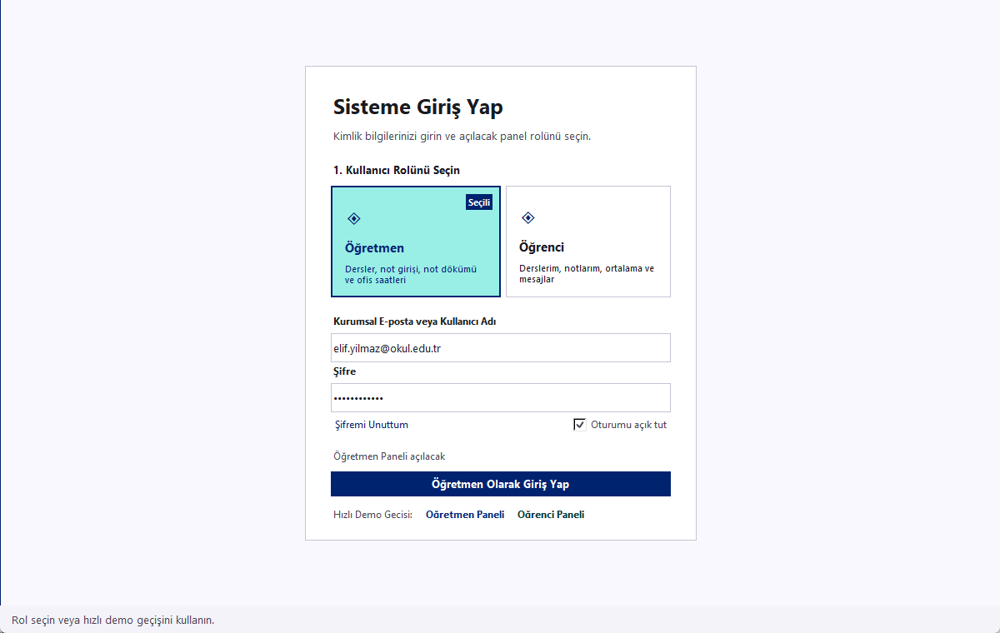
<p class="caption">Şekil 6.1 — Giriş ekranı: rol kartları, demo geçişi ve giriş formu</p>

- Sol panelde ürün adı, kısa tanım ve dönem bilgisi.
- Sağda seçilebilir **Öğretmen** / **Öğrenci** kartları, kullanıcı adı ve şifre alanları.
- Rol değişince kart rengi, giriş düğmesi ve açılacak panelin adı birlikte güncellenir.

### Öğretmen ana sayfası


<p class="caption">Şekil 6.2 — Öğretmen ana sayfası: özet kartları ve hızlı işlemler</p>

- Üst yatay gezinme: Ana Sayfa, Dersler, Öğrenciler, Notlar, Not Dökümü, Mesajlar.
- Dört özet kartı: Öğrenci, Ders, Not Kaydı ve Ortalama GNO.
- Derslerim ve Son Notlar panelleri; "Not Dökümü Oluştur" ve "Yeni Not Gir" kısayolları.

### Öğrenci ana sayfası

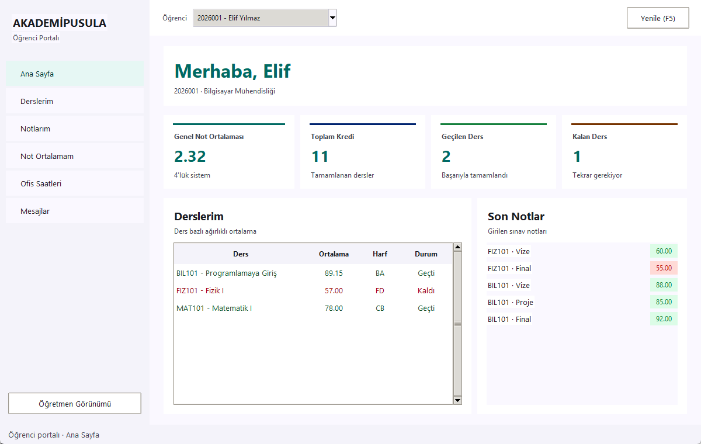
<p class="caption">Şekil 6.3 — Öğrenci portalı: sol kenar çubuğu ve karne özeti</p>

- Sol kenar çubuğu: Ana Sayfa, Derslerim, Notlarım, Not Ortalamam, Ofis Saatleri, Mesajlar.
- Üstte öğrenci seçimi; seçim tüm öğrenci ekranlarına uygulanır.
- Genel Not Ortalaması, Toplam Kredi, Geçilen Ders ve Kalan Ders kartları.

## 6.4 İşlem Ekranları

### Öğrenciler

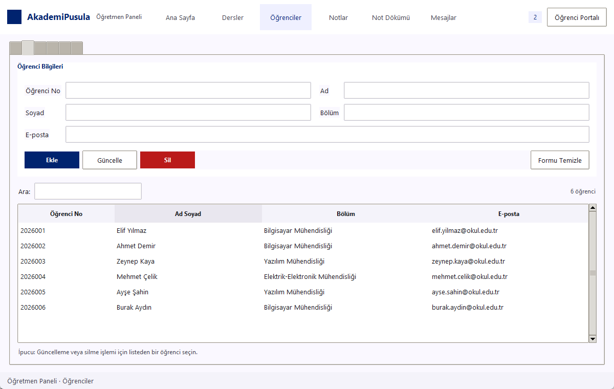
<p class="caption">Şekil 6.4 — Öğrenciler ekranı: form, eylemler, arama ve liste</p>

- Üstte `LabelFrame` içinde 5 alanlı form.
- Form altında Ekle / Güncelle / Sil / Formu Temizle.
- Altta arama kutusu, sayaç ve `Treeview`.
- Satır seçimi formu doldurur; seçim kaybolursa form temizlenir.

### Dersler

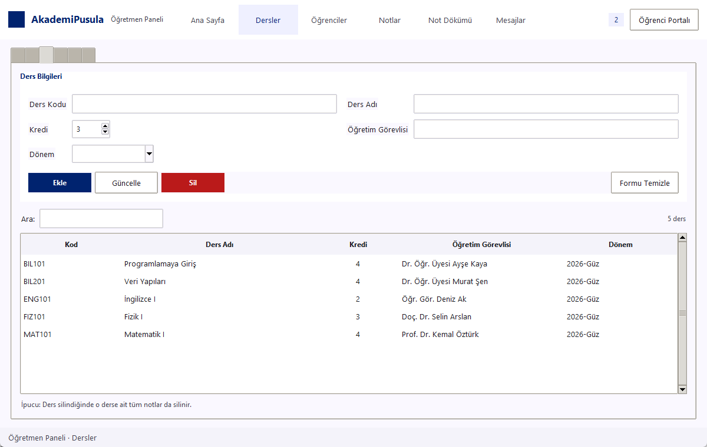
<p class="caption">Şekil 6.5 — Dersler ekranı: ders kodu, ad, kredi ve dönem yönetimi</p>

- Form: Ders Kodu, Ders Adı, Kredi (Spinbox), Öğretim Görevlisi, Dönem (Combobox).
- Liste: Kod, Ders Adı, Kredi, Öğretim Görevlisi, Dönem.
- Kredi varsayılanı 3; kod büyük harfe çevrilir.

### Notlar

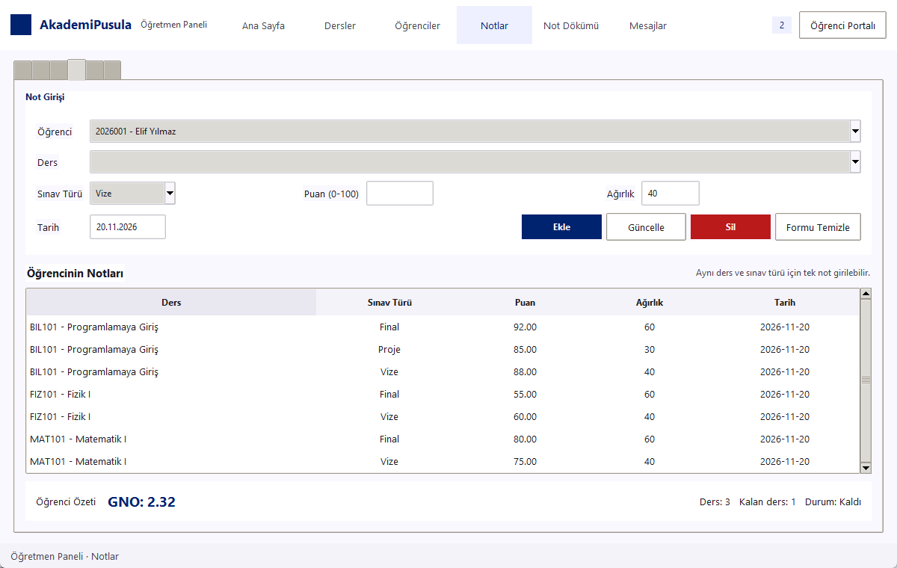
<p class="caption">Şekil 6.6 — Notlar ekranı: not formu, not listesi ve GNO özet kartı</p>

- Form: Öğrenci (readonly Combobox), Ders (readonly Combobox), Sınav Türü, Puan, Ağırlık, Tarih.
- Sınav türü değiştiğinde ağırlık otomatik güncellenir.
- Liste: Ders, Sınav Türü, Puan, Ağırlık, Tarih.
- Alt kart: GNO, ders sayısı, kalan ders, durum.
- Aynı ders/tür için ikinci kayıt veritabanı tarafından engellenir.

### Raporlar

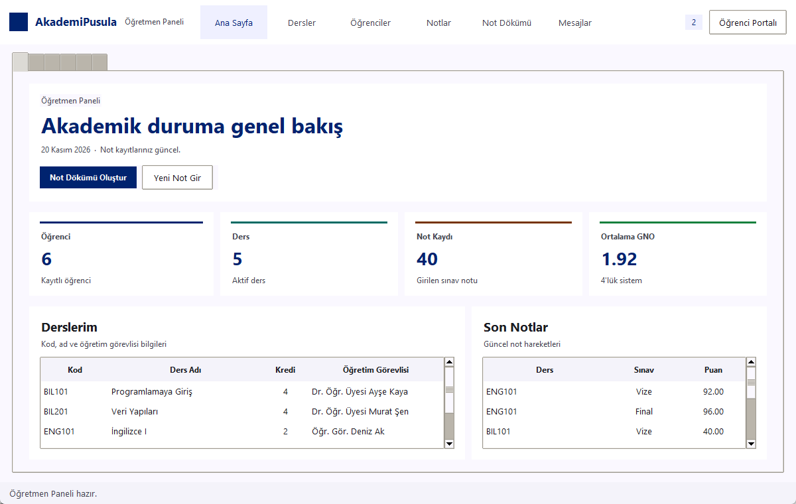
<p class="caption">Şekil 6.7 — Raporlar ekranı: önizleme ve PDF/CSV dışa aktarma</p>

- Üstte öğrenci seçimi ve "Önizlemeyi Yenile".
- Ortada monospace `Text` önizleme (yatay/dikey kaydırma).
- Altta dışa aktarma düğmeleri ve klasör açma.
- "Tüm sınıf (özet)" varsayılan seçenektir.

### Not Dökümü ve Mesajlar

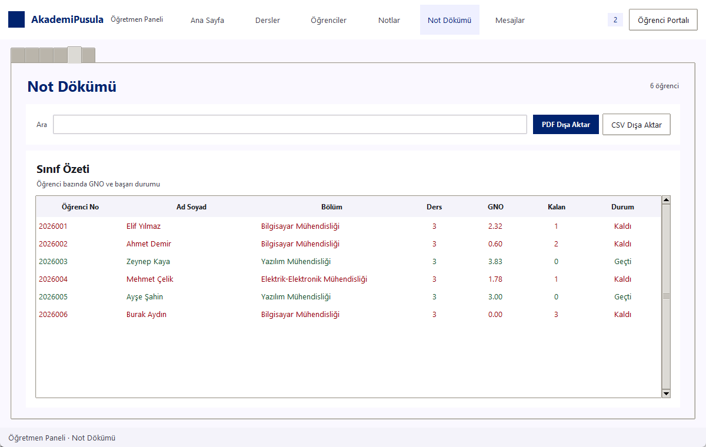
<p class="caption">Şekil 6.8 — Not dökümü: sınıf özeti, arama ve dışa aktarma</p>

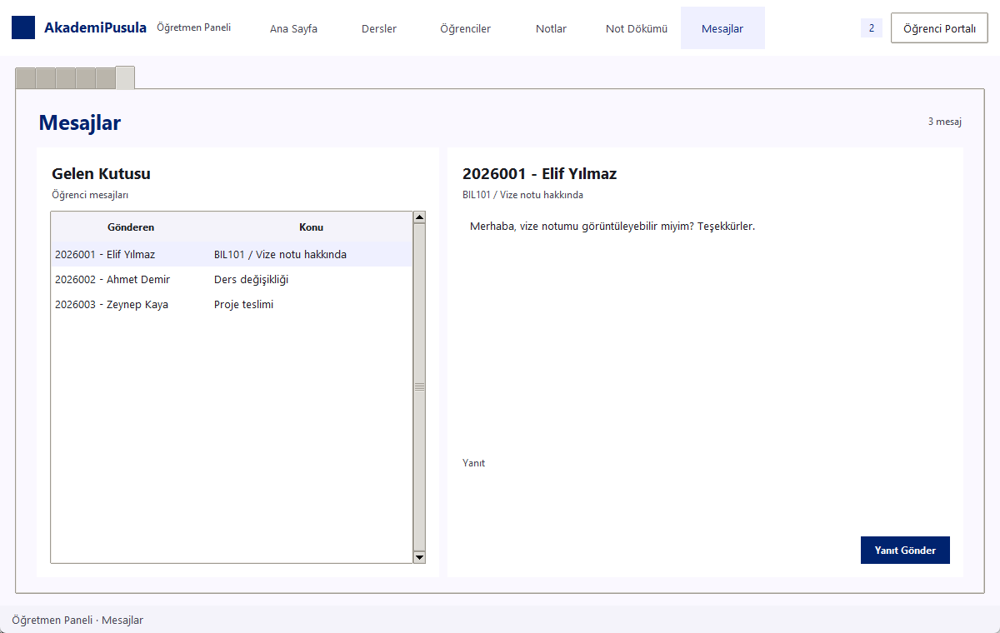
<p class="caption">Şekil 6.9 — Mesajlar: konuşma listesi ve yanıt alanı</p>

## 6.5 Durum Geçişleri

| Ekran durumu | Tetikleyici | Görünüm |
| --- | --- | --- |
| Boş veritabanı | İlk açılış | Listeler boş, sayaç 0, özet "Not yok" |
| Seçim yok | Form temizleme | Güncelle/Sil uyarı verir |
| Seçim var | Satır tıklama | Form dolar, işlemler aktif |
| Kayıt başarılı | Ekle/Güncelle | Durum çubuğu + liste yenilenir |
| Hata | Geçersiz girdi | Hata kutusu, form korunur |
| Rapor kaydedildi | Dışa aktar | Bilgi kutusu + durum çubuğu |

# 7. Dış Arayüz Tasarımı

## 7.1 Komut Satırı Arayüzü

| Komut | Etki |
| --- | --- |
| `python main.py` | Varsayılan `data/notlar.db` ile açılır |
| `python main.py --demo` | Eksik demo verileri ekleyip açar |
| `python main.py --db baska.db` | Belirtilen SQLite dosyasını kullanır |
| `python main.py --version` | Sürümü yazıp çıkar |
| `python main.py --help` | Kullanım bilgisi |

## 7.2 Dosya Sistemi Arayüzü

| Yol | Amaç | Oluşturma |
| --- | --- | --- |
| `data/notlar.db` | Varsayılan veritabanı | İlk açılışta |
| `cikti/` | PDF/CSV varsayılan klasörü | Dışa aktarmada |
| `assets/app_icon.png` / `.ico` | Uygulama ikonu | Depoda hazır |
| `docs/` | Doküman ve diyagramlar | Depoda hazır |

Dosya adları kullanıcı tarafından seçilir; varsayılan adlar tarih ve öğrenci numarası içerir.

## 7.3 Veritabanı Arayüzü

- SQLite 3, dosya tabanlı; sunucu yok.
- Bağlantı `sqlite3.connect(path)` ile açılır.
- `row_factory = sqlite3.Row` ile sütun adına erişim sağlanır.
- Tüm yazma işlemleri `cursor()` bağlam yöneticisi üzerinden yapılır.
- Şema `CREATE TABLE IF NOT EXISTS` ile her açılışta doğrulanır.

## 7.4 PDF Arayüzü

- `fpdf2` ile A4 dikey.
- Başlık: rapor adı + uygulama adı + tarih.
- Alt bilgi: `Sayfa X / Y`.
- Tablo: açık mavi başlık, zebra satır, 8–9 pt.
- Unicode font: Arial → Segoe UI → DejaVu → Liberation → Helvetica.
- Font bulunamazsa Türkçe karakterler latin-1 karşılıklarına çevrilir (kayıp kabul edilebilir, çökme yok).

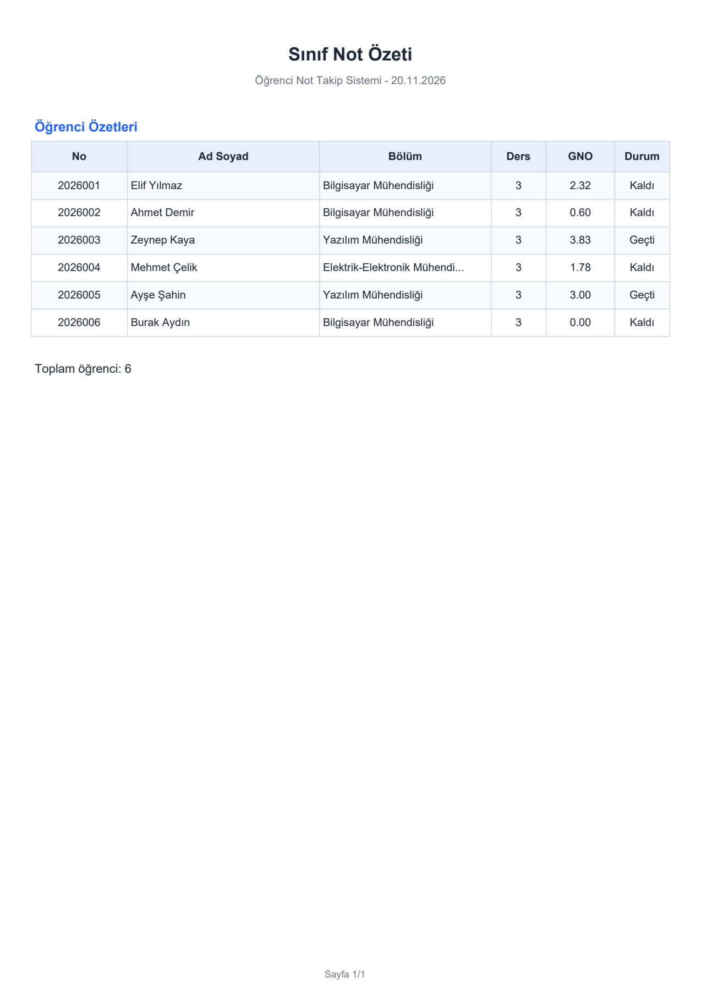
<p class="caption">Şekil 7.1 — Sınıf raporu PDF'inin ilk sayfası (A4, fpdf2)</p>

## 7.5 CSV Arayüzü

- Ayırıcı `;`, kodlama `utf-8-sig`.
- İlk satırlar anahtar-değer; ardından boş satır ve tablo başlığı.
- Excel'de çift tıkla açılabilir.

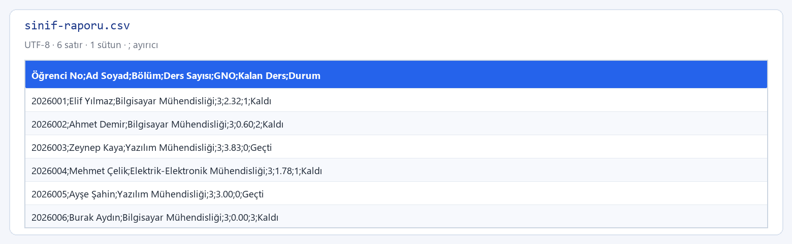
<p class="caption">Şekil 7.2 — Sınıf raporu CSV'sinin tablo görünümü (Excel uyumlu)</p>

## 7.6 İşletim Sistemi Entegrasyonu

- Windows'ta `os.startfile`, macOS'ta `open`, Linux'ta `xdg-open` ile çıktı klasörü açılır.
- Pencere kapatma olayı veritabanı bağlantısını kapatır.
- Yol birleştirme `pathlib.Path` ile yapılır; platform bağımsızdır.

# 8. Güvenlik ve Performans Tasarımı

## 8.1 Güvenlik

| Tehdit | Etki | Önlem |
| --- | --- | --- |
| SQL enjeksiyonu | Veri sızıntısı/bozulması | Tüm sorgularda parametre (`?`) |
| Geçersiz girdi | Bozuk veri, çökme | Servis doğrulaması + DB CHECK |
| Yetkisiz erişim | Veri gizliliği | Uygulama yerel; işletim sistemi kullanıcı hesabına bağlı |
| Veri kaybı | Kayıt kaybı | SQLite backup API, cascade bütünlüğü |
| Hatalı silme | Geri alınamaz kayıp | Onay kutusu + açıklama |
| Dosya yolu sorunu | Yazma hatası | `Path`, hedef klasör oluşturma, `OSError` yakalama |
| Ağ saldırısı | - | Uygulama ağ bağlantısı kurmaz |

**Not:** Uygulama çok kullanıcılı değildir; kimlik doğrulama ve rol yönetimi kapsam dışıdır. Bu, yerel tek kullanıcı varsayımının bilinçli bir sonucudur.

## 8.2 Performans

| İşlem | Karmaşıklık | Beklenen süre |
| --- | --- | --- |
| Öğrenci listesi | O(n) | 1.000 kayıt < 100 ms |
| Öğrenci arama | O(n) (LIKE) | 1.000 kayıt < 150 ms |
| Not listesi | O(k) (indeksli) | < 50 ms |
| Karne hesabı | O(k × d) | < 100 ms |
| Sınıf özeti | O(n × k) | 100 öğrenci < 1 s |
| PDF üretimi | O(k) | < 500 ms |
| CSV üretimi | O(k) | < 100 ms |

**Tasarım önlemleri**

- Yabancı anahtar alanlarında indeks.
- Raporlarda yalnızca gerekli sütunların seçilmesi.
- Ağır hesaplamanın saf fonksiyonlarda tutulması (kolay ölçüm).
- Arayüzde gereksiz yenileme yapılmaması; `notify_change` tek noktadan yeniler.
- Büyük veri için ileride sayfalama ve arka plan iş parçacığı planlanmıştır.

## 8.3 Güvenilirlik

- Boş veritabanı, eksik tablo ve geçersiz kayıt durumları test edilir.
- Transaction rollback testi (`TC-DB-06`) hata sonrası verinin korunduğunu doğrular.
- Font bulunamazsa PDF üretimi çökmez; latin-1 fallback devreye girer.
- Rapor hedef klasörü yoksa oluşturulur.
- Kullanıcı onayı olmadan silme yapılmaz.

# 9. Kısıtlar

## 9.1 Teknik Kısıtlar

| Kısıt | Etki | Azaltma |
| --- | --- | --- |
| SQLite tek yazıcı | Eşzamanlı yazma sınırlı | Tek kullanıcı varsayımı |
| Tkinter görünümü | Platforma göre küçük farklar | `clam` teması, sabit font |
| PDF fontları | Türkçe için sistem fontu gerekir | Font çözümleme zinciri + fallback |
| Python 3.10+ | Eski sürümlerde çalışmaz | README'de açık gereksinim |
| Ağ yok | Bulut senkronizasyonu yok | Yerel yedekleme |

## 9.2 Proje Kısıtları

- Ekip 2 öğrencidir; kapsam küçük tutulmuştur.
- Teslim süresi tek dönemdir; özellikler Must/Should/Could olarak önceliklendirilmiştir.
- Değerlendirme ortamında Git kurulu olmayabilir; kaynak kod ve dokümanlar dosya olarak teslim edilir.
- Arayüz otomatik testleri CI'da çalıştırılmaz; manuel duman testiyle desteklenir.

## 9.3 Varsayımlar

- Kullanıcı aynı anda tek uygulama örneği çalıştırır.
- Veritabanı yerel diskte ve yeterli boş alan vardır.
- Ders kredisi ve sınav ağırlığı makul aralıklardadır.
- Türkçe harf ölçeği kurumdan kuruma değişebilir; bu projede 60 geçme eşiği ve AA–FF ölçeği sabittir.

# 10. Tasarım Kararları

| ID | Karar | Alternatifler | Gerekçe | Sonuç |
| --- | --- | --- | --- | --- |
| ADR-01 | Tkinter masaüstü | Flask/web, PyQt | Ek kurulum yok, tek dosya çalışır | Hızlı prototip, sınırlı görsel esneklik |
| ADR-02 | SQLite | PostgreSQL, JSON dosyası | Sunucusuz, ACID, taşınabilir | Tek kullanıcı sınırı |
| ADR-03 | Katmanlı mimari | Tek dosya, MVC framework | Test edilebilirlik, net sorumluluk | Daha fazla dosya |
| ADR-04 | Saf `grading.py` | Servis içinde hesap | Hızlı, bağımsız test | Kural değişimi tek yerde |
| ADR-05 | Dataclass modeller | Sözlük, ORM | Hafif, tip güvenli | Elle eşleme (`from_row`) |
| ADR-06 | Hesaplanan değerleri saklamamak | Ortalama kolonu | Tutarlılık, kural değişimine dayanıklılık | Her okumada hesap |
| ADR-07 | `fpdf2` | reportlab, WeasyPrint | Hafif, Türkçe font desteği | PDF bağımlılığı |
| ADR-08 | CSV `;` + `utf-8-sig` | `,` + `utf-8` | Excel Türkçe uyumu | Bazı araçlarda ayar gerekir |
| ADR-09 | Parametreli SQL | ORM | Şeffaf, bağımlılıksız | SQL bilgisi gerekir |
| ADR-10 | Onaylı silme | Doğrudan silme | Veri kaybını azaltır | Ek tıklama |

# 11. Gelecek Çalışmalar

- Dönem bazlı filtreleme ve dönem kapanışı,
- Devamsızlık ve otomatik "kaldı" işaretleme,
- Excel `.xlsx` dışa aktarma,
- Çoklu kullanıcı, öğretmen girişi ve rol yönetimi,
- Arayüz için `pytest` + `xvfb` otomatik testleri,
- FTS5 ile hızlı arama,
- Bulut yedekleme ve isteğe bağlı web portalı,
- Kurum bazlı harf ölçeği yapılandırması.

# 12. Ekler

## 12.1 Dosya–Sorumluluk Haritası

| Dosya | Satır (yaklaşık) | Sorumluluk |
| --- | --- | --- |
| `main.py` | 53 | CLI, açılış, hata koruması |
| `app/config.py` | 25 | Sabitler |
| `app/database.py` | 101 | Bağlantı, şema, transaction |
| `app/models.py` | 139 | Veri modelleri |
| `app/grading.py` | 81 | Saf hesaplama |
| `app/validators.py` | 75 | Doğrulama |
| `app/errors.py` | 13 | Hata türleri |
| `app/demo_data.py` | 109 | Demo veri |
| `app/services/student_service.py` | 90 | Öğrenci işlemleri |
| `app/services/course_service.py` | 80 | Ders işlemleri |
| `app/services/grade_service.py` | 194 | Not ve karne |
| `app/services/report_service.py` | 353 | PDF/CSV/önizleme |
| `app/ui/app_window.py` | 157 | Ana pencere |
| `app/ui/students_tab.py` | 178 | Öğrenci sekmesi |
| `app/ui/courses_tab.py` | 194 | Ders sekmesi |
| `app/ui/grades_tab.py` | 304 | Not sekmesi |
| `app/ui/reports_tab.py` | 224 | Rapor sekmesi |
| `app/ui/common.py` | 100 | Tema ve yardımcılar |

## 12.2 Gereksinim–Tasarım Eşlemesi

| Gereksinim | Tasarım bileşeni | Doğrulama |
| --- | --- | --- |
| FR-01 – FR-08 | `StudentService`, `StudentsTab` | `tests/test_students.py` |
| FR-09 – FR-16 | `CourseService`, `CoursesTab` | `tests/test_courses.py` |
| FR-17 – FR-27 | `GradeService`, `GradesTab` | `tests/test_grades.py` |
| FR-28 – FR-35 | `grading.py` | `tests/test_grading.py` |
| FR-36 – FR-44 | `ReportService`, `ReportsTab` | `tests/test_reports.py` |
| FR-45 – FR-50 | `Database`, `demo_data.py`, `AppWindow` | `tests/test_database.py`, `test_demo_data.py` |

## 12.3 Sözlük

| Terim | Açıklama |
| --- | --- |
| Katman | Aynı sorumluluğu paylaşan modül grubu |
| Saf fonksiyon | Yan etkisi olmayan, aynı girdiye aynı çıktıyı veren fonksiyon |
| Transaction | Geri alınabilir veritabanı işlem bloğu |
| Cascade | Üst kayıt silinince alt kayıtların da silinmesi |
| Idempotent | Aynı işlemin tekrar edilmesinin sonucu değiştirmemesi |
| Fallback | Birincil yöntem başarısızsa devreye giren yedek yöntem |
