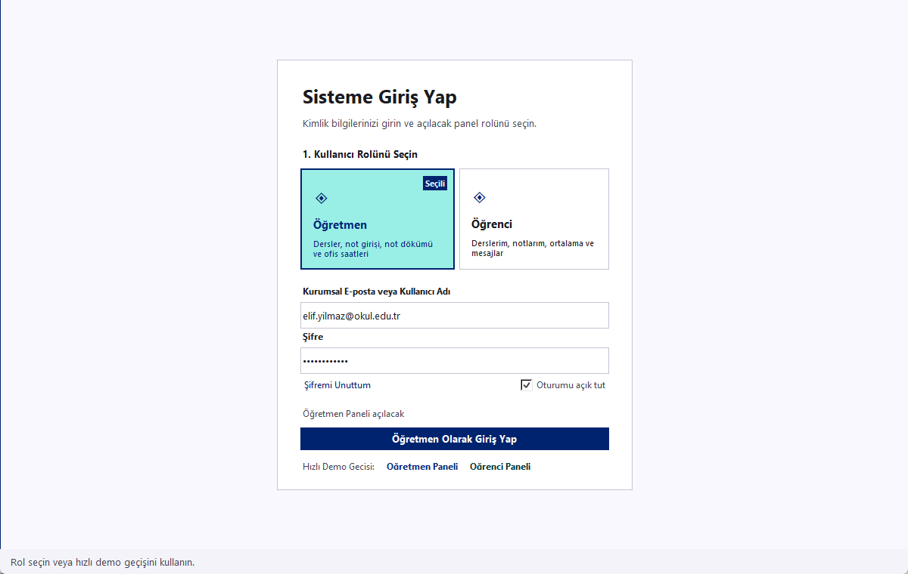
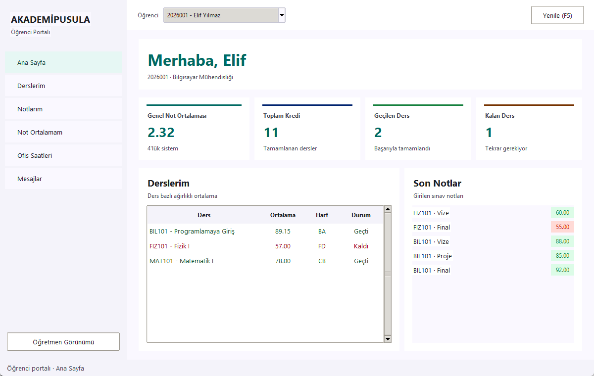
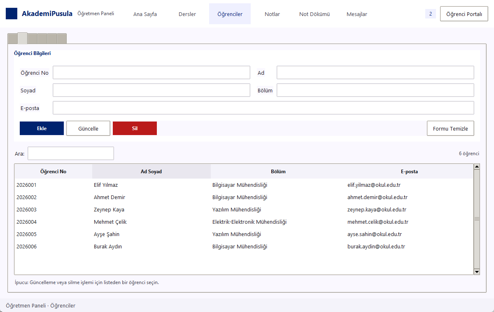
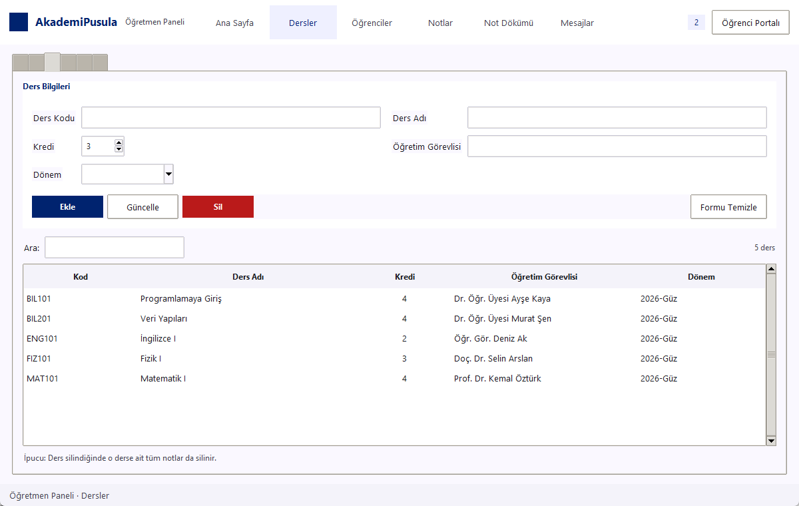
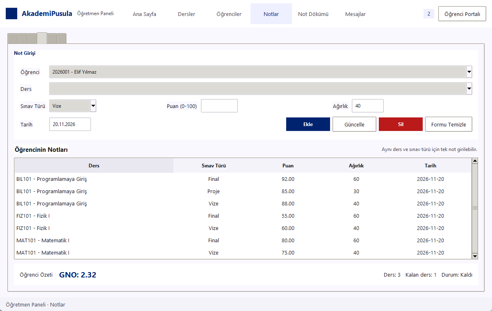
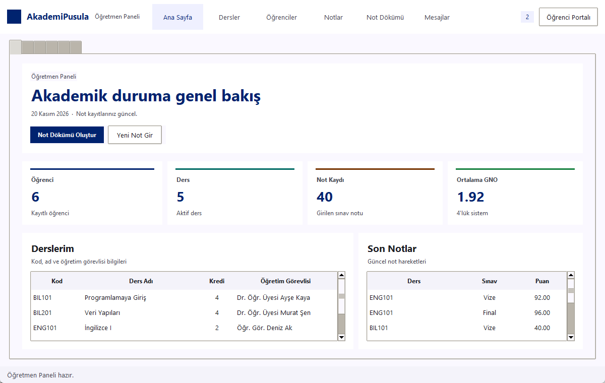

# 1. Giriş

## 1.1 Amaç

Bu doküman, **Öğrenci Not Takip Sistemi (ONTS)** için geliştirilecek yazılımın işlevsel ve işlevsel olmayan gereksinimlerini, veri gereksinimlerini, kullanıcı beklentilerini ve arayüz tasarımını tanımlar. Doküman; geliştirme ekibi, proje danışmanı ve değerlendirici arasında ortak bir anlayış oluşturmayı ve teslim edilen prototipin hangi ölçütlere göre kabul edileceğini netleştirmeyi amaçlar.

Gereksinimler, mümkün olduğunca **test edilebilir** biçimde yazılmıştır. Her işlevsel gereksinim bir kimlik (`FR-xx`), öncelik ve kabul kriteri taşır; ilgili testler izlenebilirlik matrisinde gösterilir.

## 1.2 Kapsam

Ürün, bir öğretim görevlisinin tek bilgisayarda çalıştırabildiği masaüstü uygulamasıdır. Kapsam:

- Öğrenci kayıtlarının yönetimi,
- Ders kayıtlarının yönetimi,
- Vize, Final, Ödev ve Proje notlarının yönetimi,
- Ağırlıklı ortalama, harf notu, geçme durumu ve GNO hesabı,
- Öğrenci karnesi ve sınıf özeti,
- PDF ve CSV çıktısı,
- SQLite veritabanı, yedekleme ve demo veri,
- Test, statik analiz ve sürekli entegrasyon altyapısı.

Kapsam dışı: çok kullanıcılı istemci-sunucu mimarisi, web portalı, kimlik doğrulama/yetkilendirme, ödeme, devamsızlık, ders programı, transkript ve bulut senkronizasyonu. Bu konular "Gelecek Çalışmalar" başlığında listelenmiştir.

## 1.3 Tanımlar ve Kısaltmalar

| Terim | Açıklama |
| --- | --- |
| ONTS | Öğrenci Not Takip Sistemi |
| GNO | Genel Not Ortalaması; ders katsayılarının krediyle ağırlıklandırılmış ortalaması |
| Ağırlıklı ortalama | Σ(puan × ağırlık) / Σ(ağırlık) |
| Harf notu | AA, BA, BB, CB, CC, DC, DD, FD, FF |
| Katsayı | Harf notunun 4'lük sistemdeki değeri (AA = 4.00 ... FF = 0.00) |
| Vize | Dönem içi sınav |
| Final | Dönem sonu sınavı |
| Ödev | Dönem içi ödev notu |
| Proje | Dönem projesi notu |
| CRUD | Create, Read, Update, Delete |
| CI | Continuous Integration (sürekli entegrasyon) |
| SQA | Software Quality Assurance (yazılım kalite güvencesi) |
| FR / NFR | Functional / Non-Functional Requirement |
| US | User Story |

## 1.4 Genel Bakış

Dokümanın izleyen bölümleri şu yapıdadır:

- **Bölüm 2:** Ürünün vizyonu, hedef kullanıcıları, çalışma ortamı ve kısıtları.
- **Bölüm 3:** Önceliklendirilmiş işlevsel gereksinimler.
- **Bölüm 4:** Performans, güvenilirlik, taşınabilirlik gibi işlevsel olmayan gereksinimler.
- **Bölüm 5:** Veri varlıkları, alan kuralları ve saklama koşulları.
- **Bölüm 6:** Kullanıcı gereksinimleri ve kullanıcı hikâyeleri.
- **Bölüm 7:** Arayüz gereksinimleri, ekran yerleşimleri, girdi/çıktı tasarımı.
- **Bölüm 8:** Gereksinim–tasarım–test izlenebilirliği.
- **Bölüm 9:** Kabul kriterleri.

# 2. Genel Tanım

## 2.1 Ürün Vizyonu

Öğretim görevlisinin not tutmak için Excel dosyaları, kâğıt listeler veya farklı araçlar arasında geçiş yapması; hesaplama hatası, kayıp dosya ve tutarsız harf notu gibi sorunlara yol açar. ONTS bu dağınık süreci tek bir masaüstü uygulamasında toplar:

> "Öğrenci, ders ve not bilgisini bir kez gir; ağırlıklı ortalama, harf notu ve GNO'yu anında gör; karneni tek tıkla PDF/CSV olarak paylaş."

Ürünün temel değer önerisi; **doğru hesaplama**, **hızlı raporlama** ve **kurulum gerektirmeyen sade bir masaüstü deneyimi**dir.

## 2.2 Hedef Kullanıcılar

| Kullanıcı | Profil | Temel ihtiyaç |
| --- | --- | --- |
| Öğretim görevlisi (birincil) | Ders sorumlusu; orta düzey bilgisayar kullanımı | Notları hızlı girmek, ortalama ve karneleri almak |
| Bölüm sekreteri (ikincil) | İdari personel; yoğun veri girişi | Öğrenci/ders kayıtlarını düzenli tutmak, sınıf özeti almak |
| Öğrenci (dolaylı) | Karnesini teslim alan kişi | Okunabilir PDF/CSV karne |
| Proje değerlendiricisi | Öğretim görevlisi | Çalışan prototip ve testler |

**Persona – Öğretim Görevlisi Elif:** 120 öğrencilik üç derse girer. Notları dönem sonunda tek seferde girmek yerine sınav sonrası kademeli kaydetmek ister. Hatalı girişi düzeltmek için aynı ders ve sınav türündeki kaydı güncelleyebilmek, final sonrası tüm sınıfın GNO'sunu tek ekranda görmek ister.

**Persona – Bölüm Sekreteri Ahmet:** Yeni kayıt döneminde öğrenci ve ders bilgilerini toplu girer. Öğrenci numarasının benzersiz olması ve yanlış e-postanın engellenmesi onun için kritiktir.

## 2.3 Çalışma Ortamı

| Öğe | Gereksinim |
| --- | --- |
| İşletim sistemi | Windows 10/11 (öncelikli), Linux ve macOS desteklenir |
| Python | 3.10 veya üzeri |
| Arayüz | Tkinter (Python ile birlikte gelir) |
| Veritabanı | SQLite dosyası (`data/notlar.db`) |
| Ekran | Minimum 1000 × 660 piksel; önerilen 1200 × 760 |
| Ağ | Gerekmez; uygulama tamamen çevrimdışı çalışır |
| Yazı tipi | Segoe UI (arayüz), Arial / DejaVu Sans (PDF) |

## 2.4 Kısıtlar ve Varsayımlar

**Kısıtlar**

- Tek kullanıcılı masaüstü uygulamasıdır; eşzamanlı çok kullanıcı erişimi yoktur.
- Veriler yerel SQLite dosyasında tutulur; merkezî sunucu yoktur.
- Arayüz Türkçedir; başka dil desteği ilk sürümde yoktur.
- PDF üretimi için `fpdf2` bağımlılığı gerekir.
- Türkçe karakterli PDF için sistemde Unicode font bulunmalıdır (Windows'ta Arial mevcuttur).

**Varsayımlar**

- Kullanıcı, öğrenci ve ders bilgilerini doğru girdiğini kabul eder; sistem biçimsel doğrulama yapar, içerik doğruluğunu garanti etmez.
- Ders kredisi 1–10 arasında tam sayıdır.
- Aynı öğrencinin aynı derste aynı sınav türünden tek notu olur.
- Dönem bilgisi serbest metin değil, tanımlı seçeneklerden biridir.

## 2.5 Paydaşlar

| Paydaş | İlgi | Beklenti |
| --- | --- | --- |
| Proje ekibi (2 öğrenci) | Geliştirme ve teslim | Net gereksinim, test edilebilir kabul kriteri |
| Danışman öğretim görevlisi | Yönlendirme ve değerlendirme | Tutarlı doküman, çalışan prototip |
| Son kullanıcı (öğretim görevlisi) | Günlük kullanım | Hızlı, hatasız, Türkçe arayüz |
| Öğrenci | Karne çıktısı | Okunabilir ve doğru PDF/CSV |

# 3. Fonksiyonel Gereksinimler

Öncelik ölçeği: **Must** (vazgeçilmez), **Should** (beklenen), **Could** (faydalı). Her gereksinim için kabul kriteri ve ilgili test grubu verilmiştir. Test kimlikleri Test Sonuçları dokümanındaki tablolarla eşleşir.

## 3.1 Öğrenci Yönetimi

| ID | Gereksinim | Öncelik | Kabul kriteri | Test |
| --- | --- | --- | --- | --- |
| FR-01 | Kullanıcı yeni öğrenci ekleyebilmelidir. | Must | Zorunlu alanlar doluysa kayıt oluşur ve listede görünür. | TC-STU-01 |
| FR-02 | Sistem öğrencileri numaraya göre sıralı listelemelidir. | Must | Liste öğrenci numarasına göre artan sırada gelir. | TC-STU-11 |
| FR-03 | Kullanıcı numara, ad, soyad, bölüm veya e-posta ile arama yapabilmelidir. | Must | Yazılan metin her alanda `LIKE` ile aranır; sonuç anında güncellenir. | TC-STU-11 |
| FR-04 | Kullanıcı seçili öğrenciyi güncelleyebilmelidir. | Must | Değişiklikler kaydedilir, liste ve form tutarlı kalır. | TC-STU-07 |
| FR-05 | Kullanıcı seçili öğrenciyi silebilmelidir. | Must | Onay sonrası öğrenci ve ilişkili notları silinir. | TC-STU-10, TC-DB-04 |
| FR-06 | Öğrenci numarası benzersiz olmalıdır. | Must | Aynı numarayla ikinci kayıt reddedilir, Türkçe hata gösterilir. | TC-STU-03, TC-STU-08 |
| FR-07 | Girdi alanları biçim ve uzunluk açısından doğrulanmalıdır. | Must | Boş ad, geçersiz numara veya geçersiz e-posta kaydedilmez. | TC-STU-04, TC-STU-05, TC-STU-06 |
| FR-08 | Öğrenci numarasındaki baştaki/sondaki boşluklar temizlenmelidir. | Should | `" 2026001 "` girdisi `"2026001"` olarak kaydedilir. | TC-STU-02 |

**İş kuralları**

- Öğrenci numarası 3–20 karakter; harf, rakam, `-` ve `_` içerebilir.
- Ad ve soyad zorunlu, en fazla 50 karakter.
- Bölüm en fazla 80, e-posta en fazla 120 karakter.
- E-posta boş bırakılabilir; doluysa `ad@alan.uzanti` biçiminde olmalıdır.

## 3.2 Ders Yönetimi

| ID | Gereksinim | Öncelik | Kabul kriteri | Test |
| --- | --- | --- | --- | --- |
| FR-09 | Kullanıcı yeni ders ekleyebilmelidir. | Must | Kod, ad ve kredi geçerliyse ders oluşur. | TC-CRS-01 |
| FR-10 | Sistem dersleri koda göre sıralı listelemelidir. | Must | Liste ders koduna göre artan sırada gelir. | TC-CRS-10 |
| FR-11 | Kullanıcı ders kodu, ad, öğretim görevlisi veya dönem ile arama yapabilmelidir. | Should | Eşleşen dersler filtrelenir. | TC-CRS-10 |
| FR-12 | Kullanıcı seçili dersi güncelleyebilmelidir. | Must | Güncelleme sonrası ders bilgileri yenilenir. | TC-CRS-07 |
| FR-13 | Kullanıcı seçili dersi silebilmelidir. | Must | Onay sonrası ders ve o derse ait notlar silinir. | TC-CRS-09, TC-DB-05 |
| FR-14 | Ders kodu benzersiz olmalı ve büyük harfe çevrilmelidir. | Must | `bil101` girdisi `BIL101` olur; ikinci kez eklenemez. | TC-CRS-01, TC-CRS-03 |
| FR-15 | Ders kredisi 1–10 arasında tam sayı olmalıdır. | Must | `0`, `11`, `3.5`, boş veya metin reddedilir. | TC-CRS-04 |
| FR-16 | Ders kodu yalnızca izin verilen karakterleri içermelidir. | Must | Boşluk, `@`, tek karakter reddedilir. | TC-CRS-05 |

**İş kuralları**

- Ders kodu 2–16 karakter; harf, rakam, nokta, tire ve alt çizgi içerebilir; boşluk yerine `-` kullanılır.
- Ders adı zorunlu, en fazla 100 karakter.
- Kredi varsayılanı 3'tür.
- Dönem seçenekleri `2025-Güz` ... `2027-Bahar` arasındadır; kullanıcı serbest metin de girebilir.

## 3.3 Not Yönetimi

| ID | Gereksinim | Öncelik | Kabul kriteri | Test |
| --- | --- | --- | --- | --- |
| FR-17 | Kullanıcı seçili öğrenci ve ders için not ekleyebilmelidir. | Must | Geçerli puan kaydedilir, liste ve özet güncellenir. | TC-GR-01 |
| FR-18 | Kullanıcı mevcut notu güncelleyebilmelidir. | Must | Puan/ağırlık/tarih değişir; ortalama yeniden hesaplanır. | TC-GR-13 |
| FR-19 | Kullanıcı mevcut notu silebilmelidir. | Must | Onay sonrası kayıt silinir, özet güncellenir. | TC-GR-15 |
| FR-20 | Sınav türü Vize, Final, Ödev veya Proje olmalıdır. | Must | Başka tür (`Quiz`, `vize`) reddedilir. | TC-GR-04 |
| FR-21 | Ağırlık boş bırakılırsa sınav türünün varsayılanı kullanılmalıdır. | Must | Vize 40, Final 60, Ödev 20, Proje 30 uygulanır. | TC-GR-01 |
| FR-22 | Aynı öğrenci + ders + sınav türü için tek kayıt olmalıdır. | Must | İkinci ekleme reddedilir; güncelleme önerilir. | TC-GR-03 |
| FR-23 | Puan 0–100, ağırlık 1–100 aralığında olmalıdır. | Must | Negatif, 100 üstü, metin veya boş puan reddedilir. | TC-GR-05, TC-GR-06 |
| FR-24 | Tarih `GG.AA.YYYY` veya `YYYY-MM-DD` biçiminde girilebilmelidir. | Should | Geçerli tarih ISO olarak saklanır; geçersiz tarih reddedilir. | TC-GR-07 |
| FR-25 | Türkçe ondalık virgülü kabul edilmelidir. | Should | `"72,5"` girdisi `72.5` olarak kaydedilir. | TC-GR-02 |
| FR-26 | Sistem seçili öğrencinin notlarını listelemelidir. | Must | Notlar ders kodu ve sınav türüne göre sıralanır. | TC-GR-14 |
| FR-27 | Not ekleme/güncelleme sırasında öğrenci ve dersin var olması doğrulanmalıdır. | Must | Olmayan kimlikle işlem reddedilir. | TC-GR-08 |

## 3.4 Hesaplama

| ID | Gereksinim | Öncelik | Kabul kriteri | Test |
| --- | --- | --- | --- | --- |
| FR-28 | Ders ortalaması ağırlıklı olarak hesaplanmalıdır. | Must | Σ(puan × ağırlık) / Σ(ağırlık), 2 ondalık. | TC-GRD-01, TC-GR-09 |
| FR-29 | Puan, Türk harf notu ölçeğine çevrilmelidir. | Must | 90+ AA, 85+ BA, 80+ BB, 75+ CB, 70+ CC, 65+ DC, 60+ DD, 50+ FD, altı FF. | TC-GRD-05 |
| FR-30 | Harf notu 4'lük katsayıya çevrilmelidir. | Must | AA 4.00 ... FF 0.00. | TC-GRD-06 |
| FR-31 | Geçme durumu 60 puan eşiğine göre belirlenmelidir. | Must | 60 ve üzeri "Geçti", altı "Kaldı". | TC-GRD-07, TC-GR-10 |
| FR-32 | GNO kredi ağırlıklı hesaplanmalıdır. | Must | Σ(katsayı × kredi) / Σ(kredi), 2 ondalık. | TC-GRD-08, TC-GR-09 |
| FR-33 | Notu olmayan dersler ortalamaya ve GNO'ya dahil edilmemelidir. | Must | Yalnızca notu girilmiş dersler hesaba katılır. | TC-GR-11 |
| FR-34 | Bir dersten kalındığında öğrencinin genel durumu "Kaldı" olmalıdır. | Must | Kalan ders sayısı > 0 ise durum "Kaldı". | TC-GR-10 |
| FR-35 | Ağırlık toplamı sıfır veya negatifse ortalama `None` olmalıdır. | Should | Hesaplanamayan durum `-` olarak gösterilir. | TC-GRD-03, TC-GRD-09 |

**Hesap örneği:** Vize 80 (ağırlık 40) ve Final 60 (ağırlık 60) → (80×40 + 60×60) / 100 = **68.00** → **DC** → **Geçti**.

## 3.5 Raporlama ve Dışa Aktarma

| ID | Gereksinim | Öncelik | Kabul kriteri | Test |
| --- | --- | --- | --- | --- |
| FR-36 | Kullanıcı öğrenci karnesini ekranda önizleyebilmelidir. | Must | Dersler, ortalama, harf, durum, GNO ve toplam kredi görünür. | TC-RPT-07 |
| FR-37 | Kullanıcı sınıf özetini ekranda önizleyebilmelidir. | Must | Her öğrenci için ders sayısı, GNO, kalan ders ve durum görünür. | TC-RPT-07 |
| FR-38 | Öğrenci karnesi PDF olarak kaydedilebilmelidir. | Must | Geçerli, açılabilir A4 PDF oluşur. | TC-RPT-03 |
| FR-39 | Öğrenci karnesi CSV olarak kaydedilebilmelidir. | Must | Ayırıcı `;`, kodlama `utf-8-sig`; alanlar doğru. | TC-RPT-01 |
| FR-40 | Sınıf raporu PDF olarak kaydedilebilmelidir. | Should | Tüm öğrencileri içeren A4 PDF oluşur. | TC-RPT-04 |
| FR-41 | Sınıf raporu CSV olarak kaydedilebilmelidir. | Should | Tüm öğrenciler ve özet alanları yazılır. | TC-RPT-02 |
| FR-42 | PDF Türkçe karakterleri doğru göstermelidir. | Must | `ı, İ, ş, ğ, ç, ö, ü` bozulmadan görünür. | TC-RPT-03, TC-RPT-04 |
| FR-43 | Rapor kaydı için hedef klasör yoksa otomatik oluşturulmalıdır. | Should | Alt klasörler dahil oluşturulur. | TC-RPT-05 |
| FR-44 | Boş veritabanında rapor üretimi çökmemelidir. | Must | "Kayıtlı öğrenci yok" satırıyla geçerli dosya üretilir. | TC-RPT-06 |

**Çıktı biçimleri**

- PDF: A4 dikey, başlık, tarih, sayfa numarası, zebra tablo.
- CSV: `;` ayırıcı, `utf-8-sig`, Excel uyumlu.
- Dosya adı önerisi: `karne_<ogrenci_no>_<YYYYMMDD>.pdf`, `sinif_raporu_<YYYYMMDD>.csv`.

## 3.6 Veri ve Genel İşlevler

| ID | Gereksinim | Öncelik | Kabul kriteri | Test |
| --- | --- | --- | --- | --- |
| FR-45 | Veritabanı ve şema ilk çalıştırmada otomatik oluşturulmalıdır. | Must | Dosya yoksa oluşur; üç tablo hazır gelir. | TC-DB-01 |
| FR-46 | Kullanıcı menüden veritabanını yedekleyebilmelidir. | Should | Seçilen konuma tutarlı `.db` kopyası yazılır. | Manuel test |
| FR-47 | Kullanıcı demo veriyi tek işlemle yükleyebilmelidir. | Could | 6 öğrenci, 5 ders ve 40 not eklenir; tekrar çalıştırma çoğaltmaz. | TC-DEMO-01, TC-DEMO-02 |
| FR-48 | Kullanıcı F5 ile tüm sekmeleri yenileyebilmelidir. | Could | Liste ve özetler güncellenir. | Manuel test |
| FR-49 | İşlem sonuçları durum çubuğunda gösterilmelidir. | Should | "Öğrenci eklendi...", "Rapor kaydedildi..." mesajları görünür. | Manuel test |
| FR-50 | Silme işlemleri kullanıcı onayı olmadan yapılmamalıdır. | Must | Onay penceresi gösterilir; "Hayır" seçilirse işlem yapılmaz. | Manuel test |

# 4. İşlevsel Olmayan Gereksinimler

| ID | Kategori | Gereksinim | Ölçüt / doğrulama |
| --- | --- | --- | --- |
| NFR-01 | Performans | 1.000 öğrencilik listede arama ve listeleme 1 saniyenin altında tamamlanmalıdır. | Yerel ölçüm; indeksli sorgular |
| NFR-02 | Performans | 100 öğrencilik sınıf raporu 3 saniyede üretilmelidir. | `pytest` süresi ve manuel ölçüm |
| NFR-03 | Kullanılabilirlik | Temel bir not girişi en fazla 5 etkileşimde tamamlanmalıdır. | Kullanıcı akışı sayımı |
| NFR-04 | Kullanılabilirlik | Tüm arayüz metinleri Türkçe ve tutarlı terimlerle olmalıdır. | Ekran incelemesi |
| NFR-05 | Güvenilirlik | Uygulama boş ve dolu veritabanıyla çökmeden açılmalıdır. | Duman testi |
| NFR-06 | Güvenilirlik | Veritabanı işlemleri atomik olmalı; hata durumunda geri alınmalıdır. | TC-DB-06 |
| NFR-07 | Veri bütünlüğü | Yabancı anahtar, benzersizlik ve aralık kısıtları veritabanında uygulanmalıdır. | TC-DB-01, TC-DB-03 |
| NFR-08 | Taşınabilirlik | Windows, Linux ve macOS'ta Python 3.10+ ile çalışmalıdır. | Platforma özgü yol/font çözümlemesi |
| NFR-09 | Kurulabilirlik | Kurulum en fazla iki komutla tamamlanmalıdır. | `pip install -r requirements.txt` |
| NFR-10 | Sürdürülebilirlik | Katmanlı mimari korunmalı; iş katmanı kapsamı ≥ %90 olmalıdır. | Ölçülen %97 |
| NFR-11 | Sürdürülebilirlik | flake8 sıfır uyarı, pylint ≥ 9.00 üretmelidir. | Ölçülen 10.00 |
| NFR-12 | Test edilebilirlik | Hesaplama ve doğrulama mantığı veritabanından bağımsız test edilebilmelidir. | `test_grading.py` saf fonksiyon testleri |
| NFR-13 | Güvenlik | SQL sorguları parametreli olmalı; kullanıcı girdisi sorguya eklenmemelidir. | Kod incelemesi |
| NFR-14 | Güvenlik | Uygulama ağ bağlantısı kurmamalı, veriyi yerelde tutmalıdır. | Kaynak incelemesi |
| NFR-15 | Yerelleştirme | Türkçe karakterler arayüzde, PDF'te ve CSV'de korunmalıdır. | TC-RPT-01, TC-RPT-03 |
| NFR-16 | Kapasite | 10.000 öğrenci ve 100.000 not kaydına kadar makul performans sağlanmalıdır. | Şema ve indeks tasarımı |
| NFR-17 | Bakım | Yeni rapor türü eklemek mevcut servisleri bozmadan mümkün olmalıdır. | `ReportService` ayrımı |
| NFR-18 | Belgelenebilirlik | Kurulum, kullanım, mimari ve testler dokümante edilmelidir. | README + 5 teslim dokümanı |
| NFR-19 | Erişilebilirlik | Temel işlemler klavyeyle yapılabilmeli, kontrast yeterli olmalıdır. | `Tab`, `F5`, renk paleti |
| NFR-20 | Yedeklenebilirlik | Kullanıcı tek işlemle veritabanı yedeği alabilmelidir. | Menü → Veritabanını Yedekle |

# 5. Veri Gereksinimleri

## 5.1 Veri Varlıkları

Sistem üç ana varlık ve iki türetilmiş rapor modeli kullanır.

| Varlık | Açıklama | Anahtar |
| --- | --- | --- |
| Öğrenci (`students`) | Kayıtlı öğrenci bilgileri | `id`, iş anahtarı `student_no` |
| Ders (`courses`) | Ders tanımı ve kredisi | `id`, iş anahtarı `code` |
| Not (`grades`) | Bir öğrencinin bir dersteki sınav notu | `id`, iş anahtarı `(student_id, course_id, exam_type)` |
| Ders Ortalaması (`CourseAverage`) | Hesaplanmış ders sonucu | Türetilmiş, saklanmaz |
| Karne (`StudentReport`) | Öğrencinin tüm dersleri ve GNO'su | Türetilmiş, saklanmaz |

## 5.2 Alan Tanımları ve Kurallar

### `students`

| Alan | Tip | Zorunlu | Kural |
| --- | --- | --- | --- |
| `id` | INTEGER | Evet | PK, otomatik artan |
| `student_no` | TEXT | Evet | UNIQUE, 3–20 karakter, `[0-9A-Za-z_-]` |
| `first_name` | TEXT | Evet | 1–50 karakter |
| `last_name` | TEXT | Evet | 1–50 karakter |
| `department` | TEXT | Hayır | En fazla 80 karakter, varsayılan `''` |
| `email` | TEXT | Hayır | En fazla 120; doluysa geçerli e-posta |
| `created_at` | TEXT | Evet | Varsayılan yerel tarih-saat |

### `courses`

| Alan | Tip | Zorunlu | Kural |
| --- | --- | --- | --- |
| `id` | INTEGER | Evet | PK, otomatik artan |
| `code` | TEXT | Evet | UNIQUE, 2–16, büyük harfe normalize |
| `name` | TEXT | Evet | 1–100 karakter |
| `credit` | INTEGER | Evet | 1–10 tam sayı, varsayılan 3 |
| `instructor` | TEXT | Hayır | En fazla 80 karakter |
| `semester` | TEXT | Hayır | En fazla 30 karakter |

### `grades`

| Alan | Tip | Zorunlu | Kural |
| --- | --- | --- | --- |
| `id` | INTEGER | Evet | PK, otomatik artan |
| `student_id` | INTEGER | Evet | FK → `students.id`, CASCADE |
| `course_id` | INTEGER | Evet | FK → `courses.id`, CASCADE |
| `exam_type` | TEXT | Evet | Vize, Final, Ödev, Proje |
| `score` | REAL | Evet | 0–100 |
| `weight` | REAL | Evet | > 0, varsayılan tür ağırlığı |
| `exam_date` | TEXT | Evet | ISO `YYYY-MM-DD`, varsayılan bugün |

**Benzersizlik:** `UNIQUE (student_id, course_id, exam_type)`. Aynı öğrencinin aynı derste aynı sınav türünden iki notu olamaz.

## 5.3 Hacim ve Saklama

| Veri | Beklenen hacim | Saklama |
| --- | --- | --- |
| Öğrenci | 100 – 10.000 | Dönemler boyunca, silinene kadar |
| Ders | 20 – 500 | Silinene kadar |
| Not | 1.000 – 100.000 | Silinene kadar |
| PDF/CSV çıktıları | Kullanıcıya bağlı | Kullanıcının seçtiği klasörde |

- Veritabanı tek dosyadır; yedek almak dosya kopyası kadardır.
- Kişisel veri minimize edilir: ad, soyad, öğrenci numarası, bölüm ve e-posta dışında veri tutulmaz.
- Uygulama silinen kayıtları geri getirmez; yedekleme kullanıcının sorumluluğundadır.

## 5.4 Rapor Verisi

| Çıktı | İçerik |
| --- | --- |
| Öğrenci karnesi | Öğrenci bilgileri, ders bazlı ortalama/harf/durum, GNO, toplam kredi, kalan ders |
| Sınıf özeti | Öğrenci no, ad soyad, bölüm, ders sayısı, GNO, kalan ders, durum |
| CSV | Aynı alanlar, `;` ayırıcı, `utf-8-sig` |
| PDF | Aynı alanlar, A4, başlık ve sayfa numarası |

# 6. Kullanıcı Gereksinimleri

## 6.1 Kullanıcı Hikâyeleri

| ID | Kullanıcı hikâyesi | Öncelik | Kabul kriteri |
| --- | --- | --- | --- |
| US-01 | Bir öğretim görevlisi olarak yeni öğrenciyi hızlıca kaydetmek istiyorum; böylece dönem başında listeyi hazırlayabilirim. | Must | Form doldurulup "Ekle"ye basıldığında kayıt listede görünür. |
| US-02 | Bir öğretim görevlisi olarak öğrenciyi numarasından bulmak istiyorum; böylece kalabalık listede zaman kaybetmem. | Must | Arama kutusuna yazılan numara sonucu anında filtreler. |
| US-03 | Bir öğretim görevlisi olarak ders tanımlamak istiyorum; böylece notları doğru derse bağlayabilirim. | Must | Ders kodu ve kredisiyle kayıt oluşur. |
| US-04 | Bir öğretim görevlisi olarak vize/final/ödev/proje notlarını girmek istiyorum; böylece dönem sonunda tek bir kaynağım olur. | Must | Her sınav türü ayrı satır olarak kaydedilir. |
| US-05 | Bir öğretim görevlisi olarak ağırlıklı ortalamayı otomatik görmek istiyorum; böylece manuel hesap hatası yapmam. | Must | Not girildiğinde ortalama ve harf anında güncellenir. |
| US-06 | Bir öğretim görevlisi olarak öğrencinin GNO'sunu görmek istiyorum; böylece genel başarıyı değerlendirebilirim. | Must | Karne ve notlar sekmesinde GNO görünür. |
| US-07 | Bir öğretim görevlisi olarak yanlış girdiğim notu düzeltmek istiyorum; böylece kayıt doğru kalır. | Must | "Güncelle" mevcut kaydı değiştirir, yenisini oluşturmaz. |
| US-08 | Bir öğretim görevlisi olarak öğrenci karnesini PDF almak istiyorum; böylece öğrenciyle paylaşabilirim. | Must | PDF açılır ve Türkçe karakterler doğru görünür. |
| US-09 | Bir bölüm sekreteri olarak sınıf özetini CSV almak istiyorum; böylece Excel'de inceleyebilirim. | Should | CSV Excel'de Türkçe karakterlerle açılır. |
| US-10 | Bir öğretim görevlisi olarak veritabanını yedeklemek istiyorum; böylece veri kaybı riskini azaltırım. | Should | Menüden seçilen konuma `.db` kopyası yazılır. |
| US-11 | Bir öğretim görevlisi olarak yanlışlıkla silmeyi engellemek istiyorum; böylece veri kaybetmem. | Must | Silme öncesi onay penceresi çıkar. |
| US-12 | Bir değerlendirici olarak uygulamanın testlerle doğrulandığını görmek istiyorum; böylece kalitesine güvenebilirim. | Must | Testler tek komutla çalışır ve raporlanır. |

## 6.2 Ana Kullanıcı Akışı

1. Uygulama açılır; veritabanı yoksa otomatik oluşturulur.
2. **Öğrenciler** sekmesinde öğrenci eklenir veya demo veri yüklenir.
3. **Dersler** sekmesinde ders tanımlanır.
4. **Notlar** sekmesinde öğrenci ve ders seçilir; sınav türü, puan, ağırlık ve tarih girilir.
5. Not eklendiğinde liste ve "Öğrenci Özeti" (GNO, kalan ders, durum) güncellenir.
6. **Raporlar** sekmesinde öğrenci seçilir; önizleme görüntülenir.
7. PDF veya CSV dışa aktarılır; dosya `cikti/` klasörüne kaydedilir.
8. Dönem sonunda **Dosya → Veritabanını Yedekle** ile yedek alınır.

## 6.3 Kullanım Durumu Özeti

| Aktör | Kullanım durumu | Tetikleyici |
| --- | --- | --- |
| Öğretim görevlisi | Öğrenci kaydı yönet | Öğrenciler sekmesi |
| Öğretim görevlisi | Ders kaydı yönet | Dersler sekmesi |
| Öğretim görevlisi | Not gir / güncelle / sil | Notlar sekmesi |
| Öğretim görevlisi | Karne ve GNO görüntüle | Notlar / Raporlar |
| Öğretim görevlisi | PDF / CSV rapor al | Raporlar sekmesi |
| Öğretim görevlisi | Veritabanını yedekle | Dosya menüsü |

# 7. Kullanıcı Arayüzü Gereksinimleri

## 7.1 Genel İlkeler

- Açılışta **Öğretmen** veya **Öğrenci** rolü seçilir; hızlı demo geçişi de sunulur.
- Öğretmen paneli üst gezinme çubuğu kullanır: Ana Sayfa, Dersler, Öğrenciler, Notlar,
  Not Dökümü, Mesajlar.
- Öğrenci portalı sol kenar çubuğu kullanır: Ana Sayfa, Derslerim, Notlarım, Not Ortalamam,
  Ofis Saatleri, Mesajlar.
- Mevcut yönetim ekranları korunur: **Öğrenciler**, **Dersler**, **Notlar**, **Raporlar**.
- Öğretmen lacivert (`#00236F`), öğrenci turkuaz (`#006A63`) renk kimliğiyle gösterilir.
- Ana eylemler formun altında; yıkıcı eylem kırmızı, birincil eylem rol rengindedir.
- Liste alanları sıralanabilir başlıklar ve kaydırma çubuğu içerir.
- Form ile liste aynı ekranda görünür; kullanıcı seçim yaptığında form otomatik dolar.
- Hata mesajları kullanıcının eylemini ve düzeltme yolunu söyler.
- Pencere 1200 × 760 açılır; minimum 1000 × 660'dır.

Giriş ekranı — rol kartları, giriş formu ve hızlı demo geçişi

Öğretmen paneli — üst gezinme ve özet kartları

Öğrenci portalı — sol kenar çubuğu ve karne özeti

## 7.2 Ekran Yerleşimi – Öğrenciler

| Bölge | İçerik | Davranış |
| --- | --- | --- |
| Başlık | Uygulama adı, veritabanı yolu | Sabit bilgi |
| Form | Öğrenci No, Ad, Soyad, Bölüm, E-posta | Zorunlu alanlar boş bırakılamaz |
| Eylemler | Ekle, Güncelle, Sil, Formu Temizle | Sil yalnızca seçim varsa ve onayla çalışır |
| Arama | Metin kutusu + "N öğrenci" sayacı | Yazdıkça filtreler |
| Liste | No, Ad Soyad, Bölüm, E-posta | Satır seçimi formu doldurur |
| İpucu | "Güncelleme veya silme için listeden seçin" | Kullanım yönlendirmesi |

## 7.3 Ekran Yerleşimi – Dersler

Dersler sekmesi — ders kodu, ad, kredi, öğretim görevlisi ve dönem

| Bölge | İçerik | Davranış |
| --- | --- | --- |
| Form | Ders Kodu, Ders Adı, Kredi, Öğretim Görevlisi, Dönem | Kod büyük harfe çevrilir, kredi varsayılanı 3 |
| Eylemler | Ekle, Güncelle, Sil, Formu Temizle | Sil yalnızca seçim varsa ve onayla çalışır |
| Arama | Metin kutusu + "N ders" sayacı | Kod ve ada göre filtreler |
| Liste | Kod, Ders Adı, Kredi, Öğretim Görevlisi, Dönem | Satır seçimi formu doldurur |
| Dönem | Combobox | 2026-Güz / 2026-Bahar / 2025-Güz / 2025-Bahar |

## 7.4 Ekran Yerleşimi – Notlar

| Bölge | İçerik | Davranış |
| --- | --- | --- |
| Form | Öğrenci, Ders, Sınav Türü, Puan, Ağırlık, Tarih | Öğrenci/ders açılır liste; ağırlık tür değişince güncellenir |
| Eylemler | Ekle, Güncelle, Sil, Formu Temizle | Seçili not varsa güncelleme aktif |
| Liste | Ders, Sınav Türü, Puan, Ağırlık, Tarih | Seçim formu doldurur |
| Özet kartı | GNO, ders sayısı, kalan ders, durum | Her işlemden sonra yenilenir |
| Uyarı | "Aynı ders ve sınav türü için tek not girilebilir" | İş kuralını hatırlatır |

## 7.5 Ekran Yerleşimi – Raporlar

| Bölge | İçerik | Davranış |
| --- | --- | --- |
| Araç çubuğu | Öğrenci seçimi, "Önizlemeyi Yenile", sayaçlar | "Tüm sınıf (özet)" varsayılan |
| Önizleme | Eş aralıklı metin tablo | Yatay/dikey kaydırma |
| Dışa Aktar | Karnesi PDF/CSV, Sınıf PDF/CSV, klasörü aç | Dosya kaydetme diyaloğu |
| Bilgi | Varsayılan `cikti` klasörü, Excel notu | Kullanıcıyı yönlendirir |

## 7.6 Girdi Tasarımı

| Alan | Bileşen | Doğrulama | Hata mesajı |
| --- | --- | --- | --- |
| Öğrenci No | Metin kutusu | 3–20 karakter, izinli karakterler, benzersiz | "Öğrenci numarası 3-20 karakter olmalı..." |
| Ad / Soyad | Metin kutusu | Zorunlu, ≤ 50 | "Ad zorunludur." |
| Bölüm | Metin kutusu | ≤ 80, isteğe bağlı | "Bölüm en fazla 80 karakter olabilir." |
| E-posta | Metin kutusu | Boş veya geçerli e-posta, ≤ 120 | "Geçerli bir e-posta adresi girin..." |
| Ders Kodu | Metin kutusu | 2–16, izinli karakterler, benzersiz | "Ders kodu 2-16 karakter olmalı..." |
| Ders Adı | Metin kutusu | Zorunlu, ≤ 100 | "Ders adı zorunludur." |
| Kredi | Spinbox | 1–10 tam sayı | "Kredi 1 ile 10 arasında..." |
| Dönem | Combobox | Tanımlı seçenekler | - |
| Sınav Türü | Combobox | Vize/Final/Ödev/Proje | "Sınav türü şunlardan biri olmalı..." |
| Puan | Metin kutusu | 0–100, virgül kabul | "Puan 0 ile 100 arasında olmalıdır." |
| Ağırlık | Metin kutusu | 1–100 veya boş | "Ağırlık 1 ile 100 arasında olmalıdır." |
| Tarih | Metin kutusu | `GG.AA.YYYY` veya `YYYY-MM-DD` | "Sınav tarihi GG.AA.YYYY veya YYYY-MM-DD..." |

**Girdi ilkeleri**

- Zorunlu alanlar etiketlerinde yıldız yerine açıklayıcı metinle belirtilir; hata anında gösterilir.
- Sayısal alanlarda Türkçe ondalık virgülü kabul edilir.
- Tarih boş bırakılırsa bugünün tarihi kullanılır.
- Aynı işlem iki kez tıklanırsa veritabanı kısıtı ikinci kaydı engeller.

## 7.7 Çıktı Tasarımı

| Çıktı | Biçim | İçerik | Örnek |
| --- | --- | --- | --- |
| Liste görünümü | Tablo | Kayıt alanları, sayaç | "6 öğrenci" |
| Öğrenci özeti | Kart | GNO, ders sayısı, kalan ders, durum | "GNO: 3.12" |
| Karne önizleme | Metin | Ders tablosu + GNO | "ÖĞRENCİ KARNESİ" |
| PDF karne | A4 PDF | Başlık, öğrenci bilgisi, tablo, özet, sayfa no | `karne_2026001_20261031.pdf` |
| CSV karne | `;` ayrımlı | Anahtar-değer + ders tablosu | `karne_2026001_20261031.csv` |
| Sınıf PDF/CSV | A4 / `;` | Tüm öğrencilerin özeti | `sinif_raporu_20261031.pdf` |
| Durum çubuğu | Metin | Son işlemin sonucu | "Rapor kaydedildi: ..." |

## 7.8 Geri Bildirim ve Hata Tasarımı

| Durum | Bileşen | Örnek |
| --- | --- | --- |
| Başarılı işlem | Durum çubuğu | "Öğrenci eklendi: Elif Yılmaz" |
| Doğrulama hatası | Hata kutusu | "Puan 0 ile 100 arasında olmalıdır." |
| Seçim eksik | Bilgi kutusu | "Önce listeden bir öğrenci seçin." |
| Yıkıcı işlem | Onay kutusu | "... silinecek. Devam edilsin mi?" |
| Beklenmeyen hata | Hata kutusu + traceback | "İşlem başarısız" |

## 7.9 Klavye ve Erişilebilirlik

- `Tab` / `Shift+Tab` ile alanlar arasında gezinme.
- `F5` tüm sekmeleri yeniler.
- `Enter` formda varsayılan eylemi tetikler (platform davranışı).
- Renk kontrastı: koyu metin (`#1f2937`) açık zemin (`#f4f6fb`) üzerinde.
- Yalnızca renge bağlı anlam yoktur; durum metinle de yazılır ("Geçti"/"Kaldı").

# 8. İzlenebilirlik Matrisi

| Gereksinim grubu | Tasarım bölümü | Test grubu | Durum |
| --- | --- | --- | --- |
| FR-01 – FR-08 (Öğrenci) | 4.3, 5.2, 6.2 | TC-STU-*, TC-DB-04 | Karşılandı |
| FR-09 – FR-16 (Ders) | 4.3, 5.2, 6.2 | TC-CRS-*, TC-DB-05 | Karşılandı |
| FR-17 – FR-27 (Not) | 4.3, 4.4, 5.2, 6.3 | TC-GR-* | Karşılandı |
| FR-28 – FR-35 (Hesaplama) | 4.2, 5.2 | TC-GRD-*, TC-GR-09/10/11 | Karşılandı |
| FR-36 – FR-44 (Rapor) | 4.5, 6.4, 7.5 | TC-RPT-* | Karşılandı |
| FR-45 – FR-50 (Veri/Genel) | 4.3, 5.1, 6.1 | TC-DB-*, TC-DEMO-*, manuel | Karşılandı |
| NFR-01 – NFR-20 | 3, 7, 8 | Ölçüm + manuel doğrulama | Karşılandı |

# 9. Kabul Kriterleri

Proje aşağıdaki koşulların tamamı sağlandığında kabul edilir:

| # | Kabul kriteri | Doğrulama |
| --- | --- | --- |
| 1 | Tüm **Must** gereksinimler çalışır durumdadır. | FR tablosu + testler |
| 2 | En az 100 otomatik test geçer. | `pytest` → 106 geçti |
| 3 | İş katmanı kapsamı ≥ %90'dır. | Ölçülen %97 |
| 4 | flake8 sıfır uyarı, pylint ≥ 9.00 üretir. | Ölçülen 10.00 |
| 5 | Uygulama boş ve dolu veritabanıyla açılır. | Duman testi |
| 6 | PDF/CSV çıktıları Türkçe karakterlerle doğrudur. | TC-RPT-01/03 |
| 7 | Silme işlemleri onay ister ve cascade çalışır. | TC-STU-10, TC-CRS-09 |
| 8 | Beş teslim dokümanı ve kaynak kod eksiksizdir. | Teslim paketi kontrolü |
| 9 | README kurulum ve kullanım adımlarını içerir. | Doküman incelemesi |
| 10 | CI yapılandırması test + kalite adımlarını çalıştırır. | `.github/workflows/ci.yml` |

# 10. Ekler

## 10.1 Öncelik Özeti

| Öncelik | Adet | Kapsam |
| --- | --- | --- |
| Must | 34 | Öğrenci, ders, not, hesaplama, temel raporlama |
| Should | 12 | Arama, tarih biçimi, sınıf raporu, yedekleme |
| Could | 4 | Demo veri, F5 yenileme, durum çubuğu ayrıntıları |

## 10.2 Varsayılan Ağırlıklar ve Harf Ölçeği

| Sınav türü | Ağırlık |
| --- | --- |
| Vize | 40 |
| Final | 60 |
| Ödev | 20 |
| Proje | 30 |

| Puan | Harf | Katsayı | Durum |
| --- | --- | --- | --- |
| 90.00 – 100 | AA | 4.00 | Geçti |
| 85.00 – 89.99 | BA | 3.50 | Geçti |
| 80.00 – 84.99 | BB | 3.00 | Geçti |
| 75.00 – 79.99 | CB | 2.50 | Geçti |
| 70.00 – 74.99 | CC | 2.00 | Geçti |
| 65.00 – 69.99 | DC | 1.50 | Geçti |
| 60.00 – 64.99 | DD | 1.00 | Geçti |
| 50.00 – 59.99 | FD | 0.50 | Kaldı |
| 0.00 – 49.99 | FF | 0.00 | Kaldı |

## 10.3 Gelecek Çalışmalar

- Dönem bazlı filtreleme ve dönem kapanışı,
- Devamsızlık takibi,
- Excel (`.xlsx`) dışa aktarma,
- Çoklu kullanıcı ve öğretmen girişi,
- Arayüz için `pytest` + `xvfb` tabanlı otomatik testler,
- Bulut yedekleme ve isteğe bağlı web portalı.
