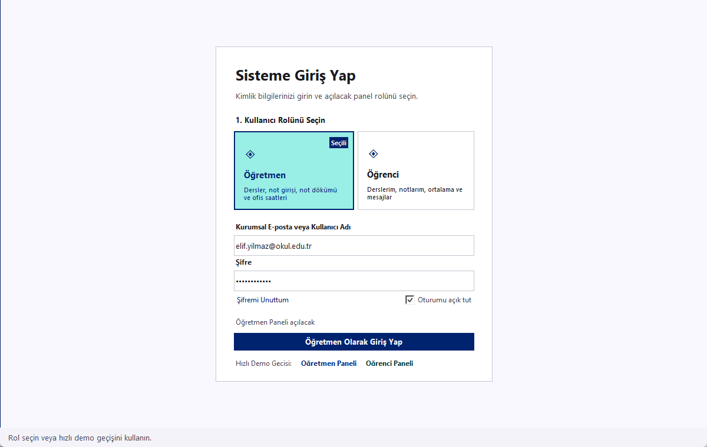
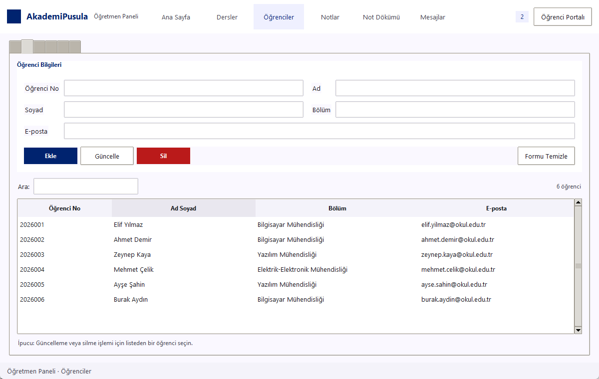
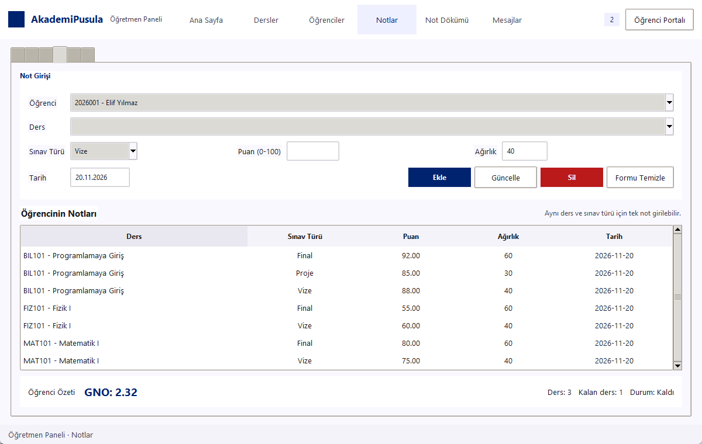
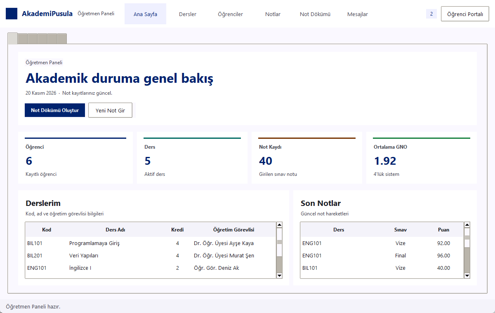
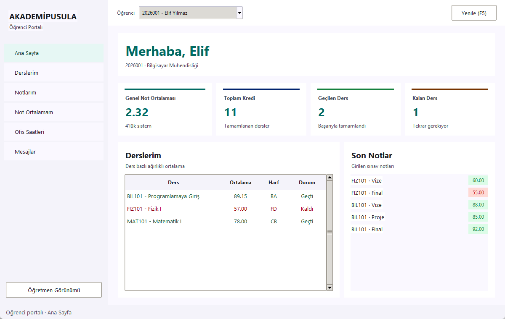
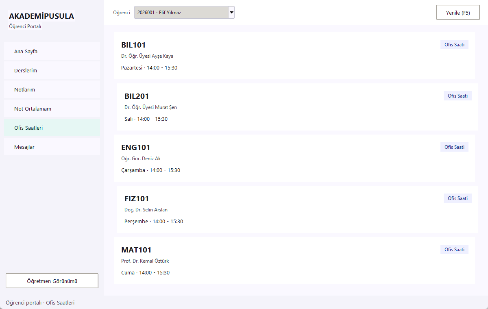
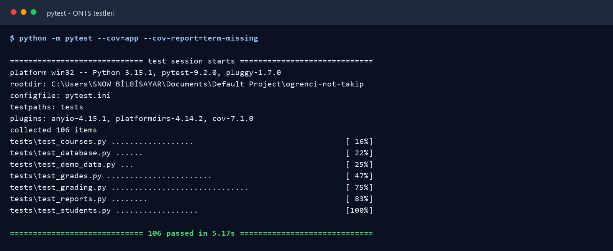
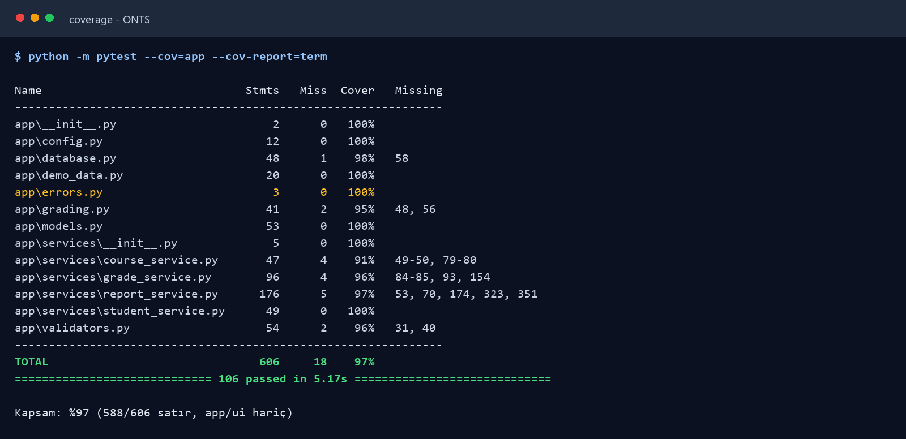

# 1. Giriş

## 1.1 Amaç

Bu doküman, Öğrenci Not Takip Sistemi'nin (ONTS) test stratejisini, test ortamını, yürütülen testleri, elde edilen sonuçları ve bulunan hataları kayıt altına alır. Amaç; yazılımın gereksinimleri karşıladığını göstermek, kalan riskleri görünür kılmak ve teslim edilen prototipin güvenilirlik düzeyini ortaya koymaktır.

Doküman; her test grubunu bir gereksinimle, her hata kaydını bir düzeltmeyle ve her metriği bir komutla ilişkilendirir.

## 1.2 Kapsam

| Kapsam içi | Kapsam dışı |
| --- | --- |
| `app/database.py`, `models.py`, `grading.py`, `validators.py` | Üçüncü taraf kütüphanelerin iç testleri |
| `app/services/*` (öğrenci, ders, not, rapor) | İşletim sistemi ve donanım testleri |
| `app/demo_data.py` | Yük/Stres testi (10.000+ kayıt) |
| `main.py` CLI davranışı (dolaylı) | Ağ/güvenlik sızma testi (uygulama ağ kullanmaz) |
| Arayüz duman testi (manuel) | Otomatik UI testi (CI'da görüntü sunucusu yok) |
| PDF/CSV çıktı üretimi | Yazıcı/Donanım uyumluluğu |

## 1.3 Test Yaklaşımı

Test piramidinin üç katmanı kullanılmıştır:

1. **Birim testleri:** Saf hesaplama (`grading.py`), doğrulama (`validators.py`) ve model davranışları. Hızlı, izole, dış bağımlılık yok.
2. **Entegrasyon testleri:** Servisler + gerçek SQLite (geçici dosya). CRUD, transaction, cascade, rapor üretimi.
3. **Sistem / duman testi:** Uygulamanın gerçek Tkinter penceresiyle açılması, dört sekmenin gezilmesi, demo ve boş veritabanı senaryoları.

Buna ek olarak **statik analiz** (flake8, pylint) ve **CI kalite kapısı** uygulanır. Testler " Arrange–Act–Assert" düzenine ve açıklayıcı isimlendirmeye uyar; her test bağımsız geçici veritabanı kullanır.

# 2. Test Ortamı

## 2.1 Donanım ve Yazılım

| Öğe | Değer |
| --- | --- |
| İşletim sistemi | Windows 11 (10.0.26200), 64-bit |
| Mimari | AMD64 |
| Python | 3.15.1 (CPython, MSC v.1951 64-bit) |
| pytest | 9.2.0 |
| pytest-cov / coverage | 7.17.0 |
| flake8 | 7.5.0 (pycodestyle 2.15.0, pyflakes 4.1.0, mccabe 0.7.0) |
| pylint | 4.1.3 |
| fpdf2 | 2.8.9 |
| SQLite | Python `sqlite3` modülü (yerel) |
| Test tarihi | 31.10.2026 |

## 2.2 Test Verisi

- Her test `tmp_path` altında yeni bir SQLite dosyası oluşturur; testler arası veri paylaşımı yoktur.
- Ortak `sample` fixture'ı bir öğrenci, iki ders ve üç not üretir.
- Demo veri testi 6 öğrenci, 5 ders ve 40 not yükler.
- Tarih içeren testlerde sabit tarih (`2026-10-01`, `2026-11-01`) kullanılır; sistem saatine bağımlılık en aza indirilir.

## 2.3 Çalıştırma Komutları

```powershell
# Tüm testler
python -m pytest -q

# Kapsam ile
python -m pytest --cov=app --cov-report=term-missing

# Statik analiz
python -m flake8 app tests main.py
python -m pylint app main.py
```

# 3. Test Özeti

## 3.1 Genel Sonuç

| Metrik | Sonuç | Hedef | Durum |
| --- | --- | --- | --- |
| Toplanan test | 106 | ≥ 100 | Karşılandı |
| Geçen test | 106 | 106 | Karşılandı |
| Başarısız test | 0 | 0 | Karşılandı |
| Atlanan test | 0 | 0 | Karşılandı |
| Toplam süre | ≈ 5.2 s | < 60 s | Karşılandı |
| İş katmanı kapsamı (`app/ui` hariç) | %97 (588/606 satır) | ≥ %90 | Karşılandı |
| flake8 uyarısı | 0 | 0 | Karşılandı |
| pylint puanı | 10.00 / 10 | ≥ 9.00 | Karşılandı |

## 3.2 Test Dağılımı

| Test dosyası | Test sayısı | Odak |
| --- | --- | --- |
| `tests/test_grading.py` | 30 | Ağırlıklı ortalama, harf sınırları, katsayı, GNO, biçimlendirme |
| `tests/test_grades.py` | 23 | Not CRUD, varsayılan ağırlık, tarih, karne, sınıf özeti |
| `tests/test_students.py` | 18 | Öğrenci CRUD, arama, benzersizlik, e-posta |
| `tests/test_courses.py` | 18 | Ders CRUD, kod normalizasyonu, kredi, arama |
| `tests/test_reports.py` | 8 | CSV içeriği, PDF üretimi, klasör oluşturma, önizleme |
| `tests/test_database.py` | 6 | Şema, FK, cascade, rollback |
| `tests/test_demo_data.py` | 3 | Demo yükleme, idempotentlik, rapor üretilebilirliği |
| **Toplam** | **106** | - |

## 3.3 Kapsam Detayı

```text
Name                              Stmts   Miss  Cover   Missing
---------------------------------------------------------------
app\__init__.py                       2      0   100%
app\config.py                        12      0   100%
app\database.py                      48      1    98%   58
app\demo_data.py                     20      0   100%
app\errors.py                         3      0   100%
app\grading.py                       41      2    95%   48, 56
app\models.py                        53      0   100%
app\services\__init__.py              5      0   100%
app\services\course_service.py       47      4    91%   49-50, 79-80
app\services\grade_service.py        96      4    96%   84-85, 93, 154
app\services\report_service.py      176      5    97%   53, 70, 174, 323, 351
app\services\student_service.py      49      0   100%
app\validators.py                    54      2    96%   31, 40
---------------------------------------------------------------
TOTAL                               606     18    97%
```

**Kapsam dışı bırakılan satırların yorumu**

- `database.py:58` – `connection` özelliğinin doğrudan kullanılmadığı dal.
- `grading.py:48, 56` – Harf ölçeğinde hiçbir eşiğe uymayan teorik `return` yolları (0 altı puan servis tarafından engellenir).
- `course_service.py:49-50, 79-80` – Güncelleme sırasında oluşabilecek benzersizlik hatası ve `count` dalı.
- `grade_service.py:84-85, 93, 154` – Güncelleme çakışması, bulunamayan silme ve `None` ortalama dalı.
- `report_service.py:53, 70, 174, 323, 351` – Font fallback, kısaltma, boş karne ve boş sınıf dalları.
- `validators.py:31, 40` – Uzunluk aşımı hata yolları.

Arayüz (`app/ui/*`) kapsam dışıdır; gerekçesi ve manuel doğrulaması bölüm 4.6'da açıklanmıştır.

# 4. Test Yürütme Detayları

## 4.1 Birim Testleri – Hesaplama (`test_grading.py`)

| TC | Senaryo | Girdi / koşul | Beklenen | Gerçek | Durum |
| --- | --- | --- | --- | --- | --- |
| TC-GRD-01 | Temel ağırlıklı ortalama | (80,40), (60,60) | 68.00 | 68.00 | Geçti |
| TC-GRD-02 | Ağırlık normalizasyonu | (100,1), (50,1) | 75.00 | 75.00 | Geçti |
| TC-GRD-03 | Sıfır ağırlık | (100,0) | `None` | `None` | Geçti |
| TC-GRD-04 | Boş liste | `[]` | `None` | `None` | Geçti |
| TC-GRD-05 | Harf sınırları (13 parametre) | 0 – 100 arası eşikler | AA…FF | AA…FF | Geçti |
| TC-GRD-06 | Katsayılar (9 parametre) | 40 – 95 | 0.0 – 4.0 | 0.0 – 4.0 | Geçti |
| TC-GRD-07 | Geçme eşiği | 60 ve 59.99 | True / False | True / False | Geçti |
| TC-GRD-08 | Kredi ağırlıklı GNO | (4.0,4), (2.0,4) | 3.00 | 3.00 | Geçti |
| TC-GRD-09 | Kredisiz GNO | `[]`, (4.0,0) | `None` | `None` | Geçti |
| TC-GRD-10 | Puan biçimlendirme | 68.0, 3.5, `None` | "68.00", "3.5", "-" | Aynı | Geçti |

**Toplam:** 30 test (parametrik genişleme dahil).

## 4.2 Birim / Entegrasyon – Veritabanı (`test_database.py`)

| TC | Senaryo | Koşul | Beklenen | Gerçek | Durum |
| --- | --- | --- | --- | --- | --- |
| TC-DB-01 | Şema oluşturma | Yeni DB | `students`, `courses`, `grades` var | Var | Geçti |
| TC-DB-02 | Bellek içi DB | `:memory:` | Sorgu çalışır | Çalıştı | Geçti |
| TC-DB-03 | Yabancı anahtar | `PRAGMA foreign_keys` | 1 | 1 | Geçti |
| TC-DB-04 | Öğrenci cascade | Öğrenci sil | İlgili notlar silinir | Silindi | Geçti |
| TC-DB-05 | Ders cascade | Ders sil | O derse ait notlar silinir | Silindi | Geçti |
| TC-DB-06 | Transaction rollback | Hata fırlat | Kayıt eklenmez | Eklenmedi | Geçti |

## 4.3 Entegrasyon – Öğrenci (`test_students.py`)

| TC | Senaryo | Girdi / koşul | Beklenen | Gerçek | Durum |
| --- | --- | --- | --- | --- | --- |
| TC-STU-01 | Ekleme ve getirme | Geçerli öğrenci | Kayıt oluşur, `full_name`/`label` doğru | Doğru | Geçti |
| TC-STU-02 | Boşluk temizleme | `" 2026009 "` | `"2026009"` | `"2026009"` | Geçti |
| TC-STU-03 | Benzersiz numara | Aynı numara | `ValidationError` | Hata | Geçti |
| TC-STU-04 | Zorunlu alanlar | Boş no/ad/soyad | `ValidationError` | Hata | Geçti |
| TC-STU-05 | Geçersiz numara (4) | `12`, boşluklu, `!`, 21 karakter | `ValidationError` | Hata | Geçti |
| TC-STU-06 | Geçersiz e-posta (4) | `elif`, `elif@`, `elif@okul`, `@okul.edu.tr` | `ValidationError` | Hata | Geçti |
| TC-STU-07 | Güncelleme | Yeni ad/soyad/bölüm | Alanlar değişir | Değişti | Geçti |
| TC-STU-08 | Güncellemede çakışma | Var olan numara | `ValidationError` | Hata | Geçti |
| TC-STU-09 | Olmayan kaydı güncelleme | id=999 | `NotFoundError` | Hata | Geçti |
| TC-STU-10 | Silme | Mevcut kayıt | Silinir; tekrar silme hata verir | Doğru | Geçti |
| TC-STU-11 | Listeleme ve arama | Ad, bölüm, e-posta | Doğru filtre | Doğru | Geçti |
| TC-STU-12 | Sayım | 0 → 1 kayıt | 0 → 1 | 0 → 1 | Geçti |

**Toplam:** 18 test.

## 4.4 Entegrasyon – Ders (`test_courses.py`)

| TC | Senaryo | Girdi / koşul | Beklenen | Gerçek | Durum |
| --- | --- | --- | --- | --- | --- |
| TC-CRS-01 | Kod normalizasyonu | `bil101` | `BIL101` | `BIL101` | Geçti |
| TC-CRS-02 | Varsayılan kredi | Kredi verilmez | 3 | 3 | Geçti |
| TC-CRS-03 | Büyük/küçük harf tekilliği | `BIL101` + `bil101` | `ValidationError` | Hata | Geçti |
| TC-CRS-04 | Geçersiz kredi (6) | 0, 11, -3, `abc`, 3.5, boş | `ValidationError` | Hata | Geçti |
| TC-CRS-05 | Geçersiz kod (4) | boş, `A`, boşluklu, `@` | `ValidationError` | Hata | Geçti |
| TC-CRS-06 | Boş ders adı | `"  "` | `ValidationError` | Hata | Geçti |
| TC-CRS-07 | Güncelleme | Kod/ad/kredi/dönem | Alanlar değişir | Değişti | Geçti |
| TC-CRS-08 | Olmayan dersi güncelleme | id=42 | `NotFoundError` | Hata | Geçti |
| TC-CRS-09 | Silme | Mevcut ders | Silinir; tekrar silme hata verir | Doğru | Geçti |
| TC-CRS-10 | Arama | `matematik`, `Kaya`, `hukuk` | Doğru sonuç/boş | Doğru | Geçti |

**Toplam:** 18 test.

## 4.5 Entegrasyon – Not ve Karne (`test_grades.py`)

| TC | Senaryo | Girdi / koşul | Beklenen | Gerçek | Durum |
| --- | --- | --- | --- | --- | --- |
| TC-GR-01 | Varsayılan ağırlık | Final, puan 70 | Ağırlık 60, tarih atanır | 60 | Geçti |
| TC-GR-02 | Virgüllü ondalık | `"78,5"`, `01.11.2026` | 78.5, 2026-11-01 | Doğru | Geçti |
| TC-GR-03 | Aynı sınav türü | Mevcut Vize | `ValidationError` | Hata | Geçti |
| TC-GR-04 | Geçersiz tür (3) | `Quiz`, boş, `vize` | `ValidationError` | Hata | Geçti |
| TC-GR-05 | Geçersiz puan (4) | -1, 101, `abc`, boş | `ValidationError` | Hata | Geçti |
| TC-GR-06 | Geçersiz ağırlık (3) | 0, 150, `ağır` | `ValidationError` | Hata | Geçti |
| TC-GR-07 | Geçersiz tarih | `2026-13-40` | `ValidationError` | Hata | Geçti |
| TC-GR-08 | Olmayan öğrenci/ders | id=999 | `NotFoundError` | Hata | Geçti |
| TC-GR-09 | Karne ortalamaları | 2 ders, 3 not | BIL 68.00/DC, MAT 90.00/AA, GNO 2.75 | Doğru | Geçti |
| TC-GR-10 | Kalan ders | Final 45 | FF, "Kaldı" | Doğru | Geçti |
| TC-GR-11 | Notsuz öğrenci | Not yok | Boş liste, GNO `None`, "Not yok" | Doğru | Geçti |
| TC-GR-12 | Olmayan öğrenci karnesi | id=999 | `NotFoundError` | Hata | Geçti |
| TC-GR-13 | Güncelleme ortalamayı değiştirir | Final 60 → 100 | 92.00 / AA | Doğru | Geçti |
| TC-GR-14 | Öğrenci/ders listeleri | 3 not | Sıra ve puanlar doğru | Doğru | Geçti |
| TC-GR-15 | Not silme | İlk not | Silinir, sayı 2 olur | Doğru | Geçti |
| TC-GR-16 | Sınıf özeti | 2 öğrenci | GNO 4.0/0.0, durum Geçti/Kaldı | Doğru | Geçti |

**Toplam:** 23 test.

## 4.6 Entegrasyon – Rapor (`test_reports.py`)

| TC | Senaryo | Girdi / koşul | Beklenen | Gerçek | Durum |
| --- | --- | --- | --- | --- | --- |
| TC-RPT-01 | Öğrenci CSV | Örnek veri | Başlıklar, BIL101 68.00/DC, MAT101 AA | Doğru | Geçti |
| TC-RPT-02 | Sınıf CSV | Örnek veri | GNO 2.75, durum Geçti | Doğru | Geçti |
| TC-RPT-03 | Öğrenci PDF | Örnek veri | `%PDF` ile başlar, > 1000 bayt | Doğru | Geçti |
| TC-RPT-04 | Sınıf PDF | Örnek veri | `%PDF` ile başlar, > 1000 bayt | Doğru | Geçti |
| TC-RPT-05 | Eksik klasör | `alt/klasor/karne.pdf` | Klasörler oluşur, dosya yazılır | Doğru | Geçti |
| TC-RPT-06 | Boş sınıf | Kayıt yok | Geçerli PDF, tek satır CSV | Doğru | Geçti |
| TC-RPT-07 | Önizlemeler | Örnek veri | "Elif Yılmaz", "BIL101", "GNO: 2.75" | Doğru | Geçti |
| TC-RPT-08 | Servis bağımlılığı | Enjekte edilen servisler | Aynı nesneler kullanılır | Doğru | Geçti |

## 4.7 Demo Veri (`test_demo_data.py`)

| TC | Senaryo | Beklenen | Gerçek | Durum |
| --- | --- | --- | --- | --- |
| TC-DEMO-01 | Demo yükleme | 51 yeni kayıt, 6 öğrenci | 51 / 6 | Geçti |
| TC-DEMO-02 | Idempotentlik | İkinci çalıştırma 0 ekler | 0 | Geçti |
| TC-DEMO-03 | Rapor üretilebilirliği | 6 özet, Geçti ve Kaldı birlikte | Doğru | Geçti |

## 4.8 Arayüz Duman Testi (Manuel)

Otomatik UI testi CI'da çalıştırılmaz (görüntü sunucusu yok). Bunun yerine aşağıdaki manuel duman testi uygulanmıştır:

| # | Adım | Beklenen | Sonuç |
| --- | --- | --- | --- |
| UI-01 | `python main.py --demo` ile aç | Giriş ekranı ve rol kartları görünür | Geçti |
| UI-02 | Öğretmen rolüyle giriş yap | Üst gezinmeli öğretmen paneli açılır | Geçti |
| UI-03 | Altı öğretmen ekranını gez | Tüm ekranlar çökmeden yüklenir | Geçti |
| UI-04 | Öğrenci rolüne geç | Sol kenar çubuklu portal açılır | Geçti |
| UI-05 | Altı öğrenci ekranını gez | Tüm ekranlar çökmeden yüklenir | Geçti |
| UI-06 | Öğrenci listesinde arama yap | Liste filtrelenir, sayaç güncellenir | Geçti |
| UI-07 | Notlar ekranında öğrenci seç | Not listesi ve GNO kartı güncellenir | Geçti |
| UI-08 | Raporlar ekranında önizleme | Karne/sınıf özeti metni görünür | Geçti |
| UI-09 | Boş veritabanıyla aç | Listeler boş, çökme yok | Geçti |
| UI-10 | Demo veri yükle | 51 kayıt eklenir, liste yenilenir | Geçti |
| UI-11 | Pencereyi kapat | Bağlantı kapanır, hata yok | Geçti |

Ekran görüntüleri: `docs/ekran-giris.png`, `docs/ekran-ogretmen-ana.png`,
`docs/ekran-ogrenciler.png`, `docs/ekran-dersler.png`, `docs/ekran-notlar.png`,
`docs/ekran-raporlar.png`, `docs/ekran-not-dokumu.png`, `docs/ekran-mesajlar.png`,
`docs/ekran-ogrenci-ana.png`, `docs/ekran-ogrenci-dersler.png`,
`docs/ekran-ogrenci-notlar.png`, `docs/ekran-ogrenci-ortalama.png`,
`docs/ekran-ogrenci-ofis.png`, `docs/ekran-ogrenci-mesajlar.png`.

Aşağıdaki görüntüler duman testi sırasında, demo veri yüklüyken alınmıştır.


<p class="caption">Şekil 4.1 — UI-01: Giriş ekranı ve rol kartları</p>


<p class="caption">Şekil 4.2 — UI-02/UI-03: Öğretmen paneli ve özet kartları</p>


<p class="caption">Şekil 4.3 — UI-06: Öğrenciler ekranı ve arama</p>


<p class="caption">Şekil 4.4 — UI-07: Notlar ekranı, not listesi ve GNO kartı</p>


<p class="caption">Şekil 4.5 — UI-08: Raporlar ekranında sınıf özeti önizlemesi</p>


<p class="caption">Şekil 4.6 — UI-04/UI-05: Öğrenci portalı ve karne özeti</p>


<p class="caption">Şekil 4.7 — UI-05: Öğrenci ofis saatleri ekranı</p>

## 4.9 Statik Analiz

### flake8

```text
python -m flake8 app tests main.py
(çıktı yok)
```

**Sonuç:** 0 uyarı. Yapılandırma: satır ≤ 100, karmaşıklık ≤ 12, test dosyalarında `E501` istisnası.

### pylint

```text
python -m pylint app main.py
Your code has been rated at 10.00/10
```

**Sonuç:** 10.00 / 10. Devre dışı bırakılan kontroller ve gerekçeleri Coding Standards dokümanında listelenmiştir.

## 4.10 CI Yürütmesi

`.github/workflows/ci.yml` her `push` (main) ve `pull_request` olayında şu adımları çalıştırır:

1. Depoyu çek (`actions/checkout@v4`),
2. Python 3.12 kur (`actions/setup-python@v5`, pip cache),
3. `requirements-dev.txt` ile bağımlılıkları kur,
4. `pytest --cov=app --cov-report=term-missing`,
5. `flake8 app tests main.py`,
6. `pylint app main.py`.

Adımlardan biri başarısız olursa iş akışı başarısız olur ve birleştirme engellenir. CI, yerel ortamdan bağımsız olarak aynı test setini doğrular.

## 4.11 Yürütme ve Kapsam Çıktıları

Testlerin yerel yürütmesi ve kapsam raporu aşağıdadır.


<p class="caption">Şekil 4.5 — pytest yürütmesi: 106 test, 0 başarısız, 5.17 s</p>


<p class="caption">Şekil 4.6 — Modül bazında kapsam: toplam %97 (588/606 satır)</p>

# 5. Test Sonuçları ve Bulgular

## 5.1 Genel Değerlendirme

- Planlanan 106 testin **tamamı geçmiştir**; başarısız, atlanan veya hata veren test yoktur.
- İş katmanı kapsamı **%97** ile %90 hedefinin üzerindedir.
- Statik analizde **sıfır flake8 uyarısı** ve **10.00 pylint puanı** elde edilmiştir.
- Kritik iş kuralları (ağırlıklı ortalama, harf sınırları, GNO, cascade, transaction, rapor üretimi) hem olumlu hem olumsuz senaryolarla doğrulanmıştır.
- Arayüz, otomatik test kapsamı dışında olmakla birlikte sekiz adımlı duman testinden geçmiştir.

## 5.2 Hata Kayıtları (Defect Log)

| ID | Başlık | Önem | Tespit | Açıklama | Düzeltme | Durum |
| --- | --- | --- | --- | --- | --- | --- |
| D-01 | Tarih hata mesajı uyuşmazlığı | Düşük | Birim testi | Test `"Tarih"` metnini arıyordu; servis `"Sınav tarihi ..."` mesajı üretiyordu. | Test beklentisi servis mesajıyla hizalandı (`"tarihi"`). | Kapalı |
| D-02 | Kullanılmayan importlar | Düşük | flake8 F401 | `reports_tab.py` içinde kullanılmayan importlar vardı. | İlgili importlar kaldırıldı. | Kapalı |
| D-03 | Devam satırı girintisi | Düşük | flake8 E128 | `tests/test_reports.py` içinde çok satırlı çağrıda hizalama hatası. | Girinti PEP 8'e uygun düzeltildi. | Kapalı |
| D-04 | Geçersiz pylint seçenekleri | Düşük | pylint uyarısı | `.pylintrc` içinde `suggestion-mode` ve `max-ancestors` tanınmıyordu. | Geçersiz/eskimiş seçenekler kaldırıldı, `max-parents` kullanıldı. | Kapalı |

**Hata özeti:** 4 hata tespit edilmiş, 4'ü kapatılmıştır. Açık hata yoktur. Tüm hatalar düşük önemdedir ve işlevsel davranışı etkilememiştir.

## 5.3 Riskler ve Sınırlamalar

| ID | Risk | Etki | Olasılık | Azaltma / not |
| --- | --- | --- | --- | --- |
| R-01 | Arayüz otomatik test edilmiyor | Orta | Orta | Manuel duman testi; yol haritasında `pytest-xvfb` |
| R-02 | PDF Türkçe fontu sisteme bağlı | Düşük | Düşük | Arial → Segoe UI → DejaVu → Liberation → latin-1 fallback |
| R-03 | SQLite tek yazıcı | Düşük | Düşük | Tek kullanıcı varsayımı; yedekleme |
| R-04 | `LIKE '%...%'` büyük veride yavaş | Düşük | Orta | Küçük ölçek; ileride FTS5 |
| R-05 | Tarih/saat sistem saatine bağlı | Düşük | Düşük | Testlerde sabit tarih; varsayılan bugün |
| R-06 | Kullanıcı hatasıyla veri kaybı | Orta | Düşük | Silme onayı + yedekleme |
| R-07 | CI ile yerel Python sürümü farkı | Düşük | Orta | CI 3.12, yerel 3.15; uyumluluk aralığı 3.10+ |

## 5.4 Gereksinim Kapsama Durumu

| Gereksinim grubu | İlgili testler | Durum |
| --- | --- | --- |
| FR-01 – FR-08 Öğrenci | TC-STU-01…12, TC-DB-04 | Tam |
| FR-09 – FR-16 Ders | TC-CRS-01…10, TC-DB-05 | Tam |
| FR-17 – FR-27 Not | TC-GR-01…16 | Tam |
| FR-28 – FR-35 Hesaplama | TC-GRD-01…10, TC-GR-09/10/11 | Tam |
| FR-36 – FR-44 Rapor | TC-RPT-01…08 | Tam |
| FR-45 – FR-50 Veri/Genel | TC-DB-01…06, TC-DEMO-01…03, UI-01…08 | Tam |
| NFR-01 – NFR-20 | Ölçüm, statik analiz, duman testi | Tam |

**Must gereksinimlerin tamamı** en az bir test veya manuel doğrulama ile kontrol edilmiştir. Should/Could gereksinimleri de kapsanmıştır; gelecek sürüm özellikleri kapsam dışıdır.

## 5.5 Bulgular

1. **Hesaplama doğruluğu:** Harf notu sınırları (89.99 → BA, 59.99 → FD gibi) parametrik testlerle tam kapsanmıştır. Yuvarlama kaynaklı sınır hatası gözlenmemiştir.
2. **Veri bütünlüğü:** Cascade ve transaction testleri, hata durumunda yetim kayıt oluşmadığını göstermiştir.
3. **Rapor çıktısı:** PDF ve CSV dosyaları geçerli biçimde üretilmekte; boş veritabanı ve eksik klasör senaryoları çökme yaratmamaktadır.
4. **Türkçe karakter:** CSV `utf-8-sig` ile Excel uyumludur; PDF'te Unicode font çözümlemesi kullanılır.
5. **Kalite kapısı:** flake8 ve pylint sonuçları temizdir; CI aynı kontrolleri otomatikleştirir.
6. **Kullanılabilirlik:** Duman testinde dört sekme ve temel akışlar hatasız çalışmıştır; silme onayı ve durum çubuğu geri bildirimi doğrulanmıştır.

# 6. Sonuçlar

## 6.1 Sonuç

Öğrenci Not Takip Sistemi prototipi, tanımlanan **Must** gereksinimlerin tamamını karşılamaktadır. 106 otomatik testin tamamı geçmiş, iş katmanı kapsamı %97'ye ulaşmış, flake8 ve pylint sonuçları hedeflenen kalite eşiklerini aşmıştır. Dört düşük önemli hata tespit edilip kapatılmış; açık hata kalmamıştır.

Bu sonuçlar, yazılımın izleme teslimi için **hazır** olduğunu ve temel işlevlerinin güvenilir biçimde çalıştığını göstermektedir. Bununla birlikte arayüzün otomatik test kapsamı dışında olması ve yük testi yapılmaması, üretim öncesi ele alınması gereken sınırlamalar olarak kayıtlıdır.

## 6.2 Öneriler

1. Arayüz için `pytest-xvfb` veya `pyautogui` tabanlı otomatik duman testleri eklenmeli.
2. 10.000 öğrenci / 100.000 not içeren yük testi yapılmalı; arama için FTS5 değerlendirilmeli.
3. PDF çıktısı için görsel regresyon testi (metin çıkarma + anahtar kelime kontrolü) eklenmeli.
4. Otomatik yedekleme ve geri yükleme akışı geliştirilmeli.
5. Kod kapsamı raporu CI'da eşik kontrolüne bağlanmalı (`--cov-fail-under=90`).
6. Kullanıcı kabul testi (UAT) gerçek bir öğretim görevlisiyle yapılmalı.

## 6.3 Teslim Durumu

| Öğe | Durum |
| --- | --- |
| Kaynak kod | Hazır |
| Test betikleri | Hazır (106 test) |
| Test raporu | Bu doküman |
| Kalite metrikleri | Hazır (`docs/kalite.md`) |
| CI yapılandırması | Hazır |
| Açık hata | Yok |

# 7. Ekler

## 7.1 Tam pytest Çıktısı

```text
........................................................................ [ 67%]
..................................                                       [100%]
=============================== tests coverage ================================
_______________ coverage: platform win32, python 3.15.1-final-0 _______________

Name                              Stmts   Miss  Cover   Missing
---------------------------------------------------------------
app\__init__.py                       2      0   100%
app\config.py                        12      0   100%
app\database.py                      48      1    98%   58
app\demo_data.py                     20      0   100%
app\errors.py                         3      0   100%
app\grading.py                       41      2    95%   48, 56
app\models.py                        53      0   100%
app\services\__init__.py              5      0   100%
app\services\course_service.py       47      4    91%   49-50, 79-80
app\services\grade_service.py        96      4    96%   84-85, 93, 154
app\services\report_service.py      176      5    97%   53, 70, 174, 323, 351
app\services\student_service.py      49      0   100%
app\validators.py                    54      2    96%   31, 40
---------------------------------------------------------------
TOTAL                               606     18    97%
106 passed in 5.17s
```

## 7.2 Test Envanteri

| Dosya | Test fonksiyonu | Parametre çarpanı | Toplam |
| --- | --- | --- | --- |
| `test_grading.py` | 10 | 13 + 9 | 30 |
| `test_grades.py` | 16 | 3 + 4 + 3 | 23 |
| `test_students.py` | 12 | 4 + 4 | 18 |
| `test_courses.py` | 10 | 6 + 4 | 18 |
| `test_reports.py` | 8 | - | 8 |
| `test_database.py` | 6 | - | 6 |
| `test_demo_data.py` | 3 | - | 3 |
| **Toplam** | **65** | **32** | **106** |

## 7.3 Kullanılan Fixture'lar

| Fixture | Sağladığı |
| --- | --- |
| `db` | `tmp_path/test.db` üzerinde yeni `Database`, test sonunda kapanır |
| `student_service` | `StudentService(db)` |
| `course_service` | `CourseService(db)` |
| `grade_service` | `GradeService(db)` |
| `report_service` | `ReportService(student_service, grade_service)` |
| `sample` | 1 öğrenci, 2 ders, 3 not içeren `SimpleNamespace` |

## 7.4 Test–Gereksinim İzlenebilirliği

| Test dosyası | Karşıladığı gereksinimler |
| --- | --- |
| `test_grading.py` | FR-28 – FR-35 |
| `test_grades.py` | FR-17 – FR-27, FR-28 – FR-35 |
| `test_students.py` | FR-01 – FR-08 |
| `test_courses.py` | FR-09 – FR-16 |
| `test_reports.py` | FR-36 – FR-44 |
| `test_database.py` | FR-45, FR-46, NFR-06, NFR-07 |
| `test_demo_data.py` | FR-47 |
| Manuel duman testi | FR-48 – FR-50, NFR-03, NFR-04, NFR-19 |
